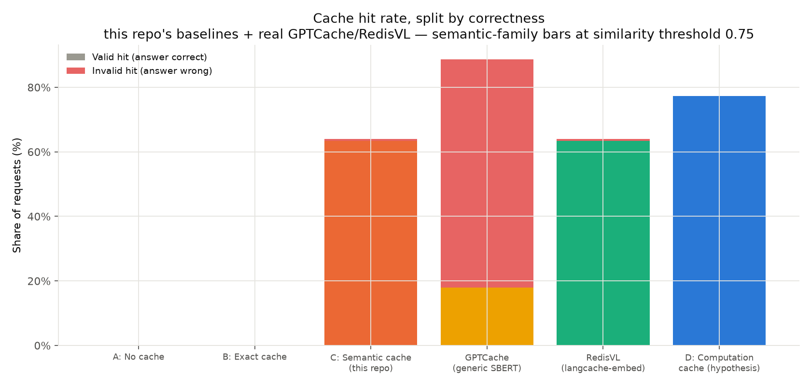
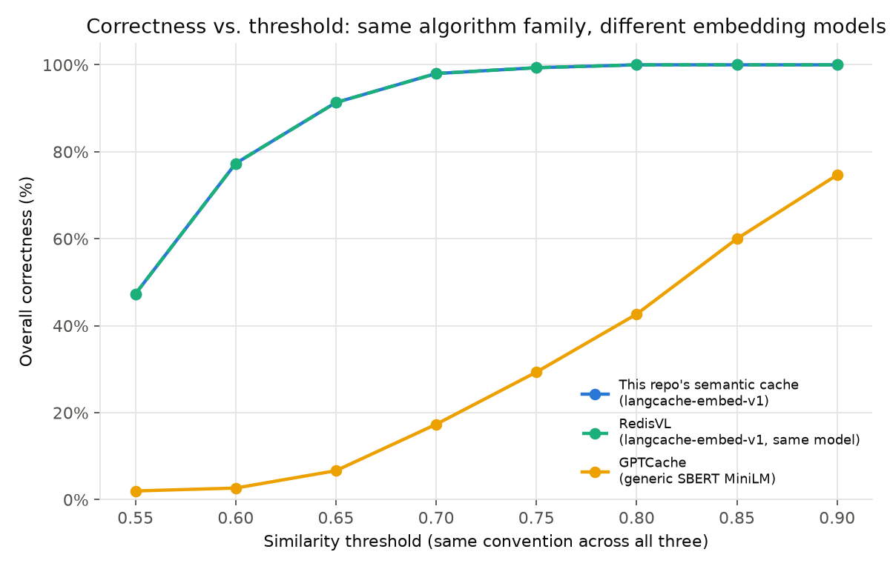

# ai-computation-cache

This repository investigates whether some AI workloads benefit more from
caching **reusable computation structure** than from caching **final
responses** — and, where they do, what that costs in terms of coverage
(how often reuse is even possible) versus what response caching gains in
correctness risk.

It is a controlled engineering investigation, not a product and not a
paper claiming a new technique. See `docs/prior-art.md` for what's
established prior art (exact caching, semantic caching, plan caching,
cost-aware eviction) versus what this repo actually tests (one specific
combination of representation, identification, binding, and validation,
on a narrow, deterministic workload family).

## Problem

Exact-match caching only reuses byte-identical requests. Semantic
caching relaxes that to "similar enough" requests — which is unsafe when
a request's *answer* depends on parameters that vary independently of
its *wording*:

```
"What is X + Y?"        X=10,  Y=20   -> 30
"Calculate X plus Y."   X=51,  Y=93   -> 144
"Can you sum X and Y?"  X=712, Y=381  -> 1093
```

These three requests are near-identical in wording and completely
different in answer. What's stable across them isn't the response —
it's the computational structure, `ADD(x, y)`. Full write-up:
`docs/problem.md`.

## Hypothesis

> Some AI workloads may benefit more from caching reusable computation
> structure than from caching final responses, when parameters vary but
> structure doesn't.

Tested via eight falsifiable sub-hypotheses (H1–H8) — see
`docs/hypotheses.md` for each one's actual outcome against this repo's
own experiment.

## Architecture

Four conditions run over the same workload with the same LLM backend
(full detail: `docs/architecture.md`):

```
A. No cache          Request -> LLM -> Answer
B. Exact cache        Request -> exact match? -> cached answer : (LLM -> store)
C. Semantic cache      Request -> embed -> nearest neighbor above threshold?
                              -> cached answer : (LLM -> store)
D. Computation cache   Request -> identify task -> retrieve computation
                              -> extract + bind parameters -> validate
                              -> valid? execute directly : fall back to LLM
```

Scope: **Level 1 (deterministic arithmetic) and Level 2 (parameterized
business formulas) only** — closed-form, deterministic tasks, which is
what makes "reuse the procedure, rebind fresh parameters, execute
directly" a coherent design. Level 3 (database-backed workflows) and
Level 4 (agent workflows) need a different computation representation
and are explicitly out of scope for this prototype — see
`docs/architecture.md`'s scope note.

## Experimental setup

- Workload: 9 canonical tasks (`add`, `subtract`, `multiply`,
  `percentage`, `compound_interest`, `revenue`, `discounted_price`,
  `tax`, `margin`), each with several paraphrase templates and randomized
  parameters. 150 requests by default, fully seeded and reproducible
  (`workloads/generators.py`).
- LLM backend: a **simulated** backend by default (deterministic,
  offline, zero cost — see `aicache/llm/simulated.py` for exactly what's
  real (token-count heuristic, published pricing) vs. synthetic (latency
  distribution) about it) and a pluggable, real **Gemini** backend
  (`aicache/llm/gemini.py`, inactive unless `GEMINI_API_KEY` is set).
- Embedding model: `redis/langcache-embed-v1` — chosen after directly
  comparing it against a generic sentence-similarity model and finding
  it separates genuine paraphrases from different-parameter requests far
  more sharply (see `docs/experiment-log.md`, EXP-005, and
  `aicache/matching/embedder.py`'s docstring).
- **External comparison baselines**: real GPTCache and real RedisVL,
  each run through the identical protocol as this repo's own semantic
  cache, in their own dependency-isolated subprocesses — see
  `docs/architecture.md`'s "External comparison baselines" section.
  Optional: skipped gracefully if the required venv/Redis instance isn't
  present.
- Metrics: hit/valid-hit/invalid-hit/miss/fallback rates, correctness
  (checked independently against ground truth, not assumed from
  outcome), tokens, cost, latency — see `docs/evaluation.md`.

Run it:

```
pip install -e .
python -m pytest tests/ -q                    # 51 tests (48 always run + 3 external, auto-skipped if unavailable)
python -m benchmarks.run_experiment           # writes results/results.csv, results/summary.json
python -m benchmarks.plots                    # writes results/*.png
```

## Results

From the run documented in full in `docs/experiment-log.md` (EXP-006;
150 requests, seed 42, simulated LLM backend, `redis/langcache-embed-v1`
embeddings):

| Baseline | Hit rate | Valid | Invalid | Correctness | Tokens | Cost (USD) |
|---|---|---|---|---|---|---|
| A — No cache | 0.0% | — | — | 100.0% | 2193 | 0.00338 |
| B — Exact cache | 0.0% | 0.0% | 0.0% | 100.0% | 2193 | 0.00338 |
| C — This repo's semantic cache (0.75) | 64.0% | 63.3% | 0.7% | 99.3% | 778 | 0.00120 |
| **RedisVL** (real system, same embedding model) | 64.0% | 63.3% | 0.7% | 99.3% | 778 | 0.00120 |
| **GPTCache** (real system, generic embedding model) | 88.7% | 18.0% | **70.7%** | **29.3%** | 194 | 0.00033 |
| D — Computation cache | 77.3% | 77.3% | **0.0%** | **100.0%** | 346 | 0.00061 |



**Two findings, not one.** First — the credibility check: this repo's
own from-scratch semantic-cache reimplementation matches RedisVL's real,
production implementation *within noise, at every threshold tested*.
It isn't a strawman.



Second — embedding model choice turns out to matter as much as, or more
than, caching algorithm choice: GPTCache's own out-of-the-box embedding
default trails RedisVL/this-repo's-cache by up to 70 percentage points
of correctness at the *identical* nominal threshold, on the *identical*
workload, run through the *identical* protocol. The full sweep
(`results/semantic_threshold_sweep.png`) shows this isn't fixable by
retuning GPTCache's threshold alone within any reasonable range.

**Headline finding, computation vs. response caching**: the computation
cache reaches a *higher* hit rate (77.3%) than any of the three
semantic-response-cache configurations at their safe operating point,
at *zero* observed invalid hits and the lowest token/cost footprint of
any caching condition tested (346 tokens / $0.00061, an 84% reduction
vs. no-cache). Its 22.7% fallback rate is a deliberate, correctness-preserving
refusal to guess, not a failure. Full numbers and interpretation:
`docs/experiment-log.md` (EXP-004 through EXP-006). All charts
(`tokens_and_cost_by_baseline.png`, `latency_by_baseline.png`,
`semantic_threshold_sweep.png`, `cross_system_correctness.png`) are in
`results/`.

## Limitations

- **Single run, single seed** — no repeated-runs variance or confidence
  intervals are reported. See `docs/evaluation.md`.
- **Deterministic tasks only** — the computation cache's zero-invalid-hit
  result depends entirely on Level 1/2 tasks being closed-form and
  side-effect-free. It does not generalize to Level 3/4 without a
  different representation.
- **Positional parameter extraction** — a real, documented limitation
  (`aicache/binding/extractor.py`); two template bugs exploiting exactly
  this limitation were found and fixed during development (see
  `docs/experiment-log.md`, EXP-002/EXP-003) — not swept under the rug.
- **Task-identification threshold is a real, narrowed-but-not-eliminated
  trade-off** — see H6 in `docs/hypotheses.md`: even with a strong
  embedding model, correct- and incorrect-match similarity ranges
  overlap slightly, and the calibrated threshold (0.52) sits inside
  that overlap by design.
- **External baselines are environment-dependent** — GPTCache/RedisVL
  results require a specific local venv layout and, for RedisVL, a
  reachable Redis instance; both are skipped gracefully (not faked) when
  absent. See `docs/evaluation.md`.
- **Simulated LLM backend by default** — see `aicache/llm/simulated.py`
  for exactly what's real vs. synthetic about its numbers. A real
  Gemini backend is wired and working (`aicache/llm/gemini.py`) and a
  spot-check against it already paid for itself: it caught a real bug
  in this repo's own correctness checker (it parsed the *first* number
  in a response, which broke against a real model showing its work —
  fixed, see `docs/experiment-log.md` EXP-007). A full-scale real-backend
  replication of EXP-006 hasn't run yet — blocked on a hard 20
  requests/day free-tier quota, not on anything left to build.
- **No eviction/admission policy of any kind** — see
  `docs/eviction-future-work.md`; explicitly deferred, not solved.

## Prior art

`docs/prior-art.md` — Redis LangCache, **RedisVL and GPTCache (both
directly benchmarked, not just described)**, vLLM prefix caching,
LMCache, Agentic Plan Caching, Google PARROT, TinyLFU/W-TinyLFU,
CacheLib, and others, mapped against this repo's own design choices.
Nothing in this repo claims to invent computation caching, semantic
caching, or cost-aware eviction.

## Future work

See `docs/eviction-future-work.md` (admission/eviction at real scale)
and the "Next experiments" notes in `docs/experiment-log.md`
(workload-repetition sweep, real-backend validation, Level 3 prototype,
hierarchical/combined baseline).

## Repository layout

```
ai-computation-cache/
├── docs/                problem, prior-art, architecture, hypotheses,
│                        evaluation, eviction-future-work, experiment-log
├── src/aicache/         the library: cache/, matching/, computation/,
│                        binding/, validation/, metrics/, llm/
├── workloads/           Level 1/2 workload generator + paraphrase templates
├── benchmarks/          baselines.py, run_experiment.py, plots.py,
│                        external/ (real GPTCache + RedisVL adapters)
├── tests/                51 unit + integration tests
├── results/             results.csv, summary.json, generated charts
└── configs/             (reserved for future experiment configs)
```
