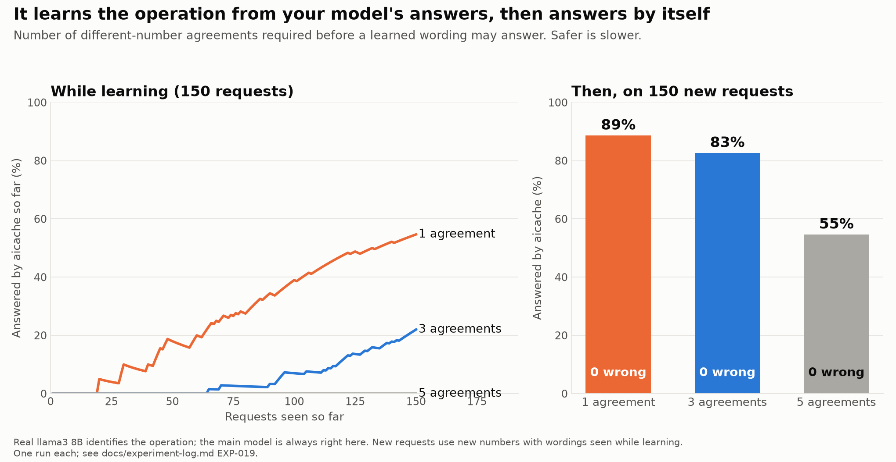
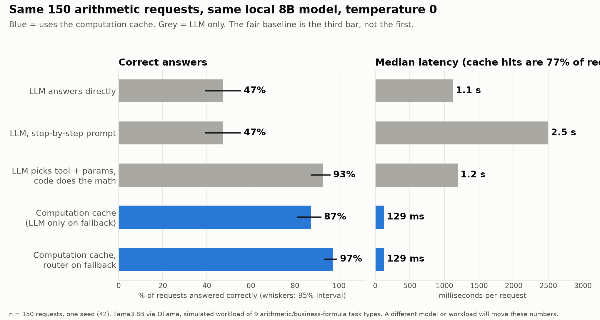
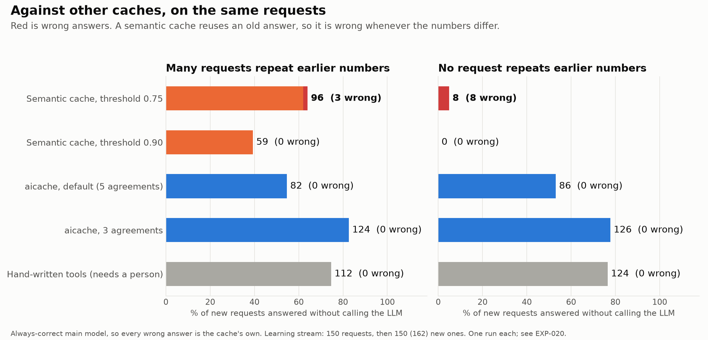
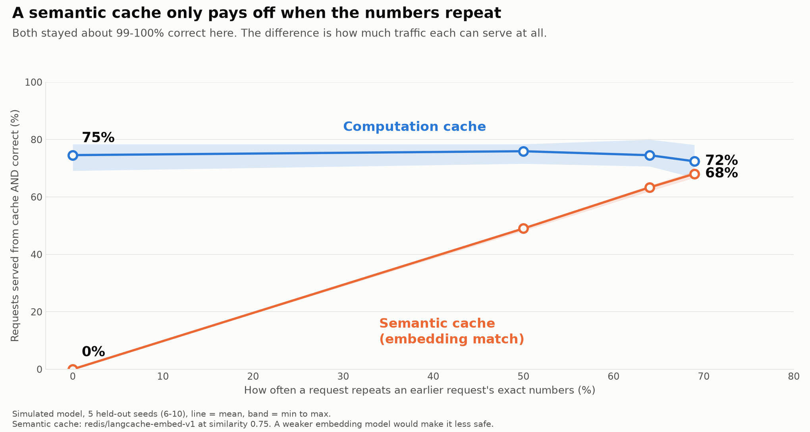

# aicache

**It learns the operation behind calculation-shaped requests from your LLM's own answers, checks it, and then answers them itself.**

An LLM app gets the same kind of request again and again with different numbers: a percentage, a price after a discount, a loan payment. A model answers each one slowly, and sometimes wrongly. A semantic cache sees two similar sentences and can return the *old number*. aicache stores the **operation** instead.

```
What is 15% of 240?   -> your model answers. aicache learns the operation: base * pct / 100
What is 20% of 50?    -> your model answers. aicache checks its formula against the answer.
  ...a few more...
What is 12% of 500?   -> aicache answers: 60. No model call.
What does percent mean? -> your model answers, as always.
```

Nothing a model proposes is trusted. A formula must reproduce your main model's answer, then agree with it on several *different* numbers before it may answer anything. See [Why it is safe](#why-it-is-safe).

**Status: alpha (0.3).** The idea is measured with real models, including where it falls short. The API may change. See [Limits](#limits).

- [How it works](#how-it-works)
- [Install](#install) and [Quickstart](#quickstart)
- [Why it is safe](#why-it-is-safe)
- [Evidence](#evidence)
- [What you get](#what-you-get)
- [Limits](#limits)
- [Guides](#guides), [Research](#research-behind-it), [Reproduce](#reproduce)

## How it works

1. **A request arrives** in natural language.
2. **A small LLM identifies the operation.** On a request the cache could not answer, your main LLM answers as usual. In the background a small model sees the request, the answer, and the request with its numbers removed (`What is {n1}% of {n2}?`). It names the operation and the roles and writes the formula. Code removes the numbers, because a model asked to copy a sentence tends to rewrite it.
3. **The masked action is embedded** (`What is #% of #?`), so requests with different numbers have the same shape.
4. **The action and its embedding are stored** in SQLite: the formula, the parameter names, a reply template, each wording seen, and the evidence for each.
5. **A later request retrieves the action,** gets its new numbers by exact alignment with a stored wording, validates them, and runs the formula.
6. **The reply** comes from the action's template with no LLM call. If the request asks for an explanation, the LLM writes it from the computed value and is told not to recompute it.

Learning runs in the background and never delays a request. Details: [how it works](docs/guide/how-it-works.md).

## Install

```bash
pip install "ai-computation-cache[embeddings,serve]"
```

The core install is small (about 77 MB, no torch). Extras: `embeddings` (local embedding model), `serve` (the gateway), `langchain`, `research` (benchmarks and plots). Without `embeddings`, use `embedder: {type: hashing}` (no download) or `type: openai` (any `/v1/embeddings` server).

## Quickstart

You need two models behind OpenAI-compatible endpoints: your **main** model, whose answers are what learning is checked against, and a **small** one that identifies operations. A local Ollama model works for both while you try it.

```yaml
# aicache.yaml
embedder: {type: sentence-transformers}
min_similarity: 0.6
upstream:                                  # your main model
  base_url: http://localhost:11434/v1
  model: llama3
learning:
  enabled: true
  store: aicache.db
  normalizer:                              # the small model
    base_url: http://localhost:11434/v1
    model: llama3
```

```bash
aicache serve aicache.yaml --port 8080     # listens on 127.0.0.1; set server.api_key_env to expose it
```

```python
from openai import OpenAI
client = OpenAI(base_url="http://127.0.0.1:8080/v1", api_key="anything")
client.chat.completions.create(model="m", messages=[{"role": "user", "content": "What is 15% of 240?"}])
```

Your app only changed its base URL. Then see what it learned and decide how much to trust it:

```bash
aicache actions aicache.yaml               # each action, its wordings and the evidence for each
aicache approve aicache.yaml percent_of    # or set learning.promotion: manual to approve everything yourself
```

From your own code, with any model or framework, two calls are the whole contract:

```python
from aicache.config import load_config
from aicache.engine import ActionCache

cache = ActionCache.from_config(load_config("aicache.yaml"))

def answer(text):
    r = cache.lookup(text)                  # ask the cache
    if r.source == "computation":
        return r.text                       # answered, no model call
    reply = call_my_model(text)             # your model, however you call it
    cache.record(text, r, reply)            # hand the answer back: this is how it learns
    return reply
```

Shortcuts: `cache.wrap(llm)`, `await cache.ahandle(text, llm)`, `cache.handle(text, llm)`, and `computation_first(cache, llm)` for LangChain and LangGraph. See [putting it in your product](docs/guide/integrate.md).

Full walkthrough: [docs/guide/quickstart.md](docs/guide/quickstart.md). A complete config is [examples/learning.yaml](examples/learning.yaml).

## Why it is safe

A model proposing formulas is the risky part, so every step is checked by code.

- **Before anything is stored:** the formula goes through a whitelist (no `eval`) and uses every parameter, and running it on the request's own numbers must reproduce the main LLM's answer. If it computes the same function as an existing action, tested on several probe values with parameters matched in every order, it joins that action. The model's naming is not trusted for this.
- **Before a wording may answer:** it spends time on *probation*, computing silently next to the LLM. It goes live only after agreeing with the LLM on several different sets of numbers and never disagreeing. One check against one request cannot rule out a formula that is right once by coincidence (2 + 2 and 2 × 2 are both 4); agreement across different numbers can. Two disagreements reject a wording for good. Or approve each one yourself.
- **Trust belongs to a wording,** not an action. A new way of asking a known operation earns trust by itself.
- **A request is answered only if it is a stored wording** with different numbers (matched up to case, spacing and end punctuation). The embedding finds candidates and never decides. An earlier design inferred where numbers sit from the surrounding words; a real-model test showed it answering an *add* request with a *multiply* action, so it was replaced before release.
- **Requests that look sensitive are never learned from:** emails, long digit runs, social security numbers, the words password, secret, token, api key. Add your own patterns.
- **Audits** can re-check a share of live answers against the main LLM and demote a wording that disagrees.

## Evidence

Everything here comes from [docs/experiment-log.md](docs/experiment-log.md) (EXP-019 for learning) and can be reproduced. Real models were used throughout: an 8B model identifying operations, the real embedding model, and for the main model either an always-correct one (to isolate the learning mechanism) or a real, fallible one.

**It learns, and it answers by itself, with no wrong answers.** With llama3 8B identifying operations and a correct main model, aicache learned 7 actions from a stream of 150 requests. On **150 new requests with new numbers** it answered **82 itself at the default setting (5 agreements) and 124 with a looser one (3)**, and sent the rest to the main model. **Zero answers were wrong in every configuration tested.** A second pair of seeds gave 121 of 150, also with none wrong.

| Small model identifying operations | Main model | Agreements required | Answered by aicache (150 new requests) | Wrong | Calls to the main model |
|---|---|---|---|---|---|
| llama3 8B | always correct | **5 (default)** | **82 (55%)** | 0 | 68 |
| llama3 8B | always correct | 3 | 124 (83%) | 0 | 26 |
| llama3 8B | always correct | 1 | 133 (89%) | 0 | 17 |
| llama3.2 1B | always correct | 3 | 52 (35%) | 0 | 98 |
| llama3 8B | llama3 8B (right about half the time) | 3 | 22 (15%) | 0 | 128 |



- **Cost.** Learning costs one extra small-model call per *new* wording, once. With 3 agreements, the first 150 requests used 117 main-model calls and 40 small-model calls, against 150 main-model calls without aicache. After that, 150 requests used 26 main-model calls instead of 150 (with 3 agreements; 68 at the default of 5).
- **The agreement threshold trades speed for caution.** One agreement learns fastest. Five, the default, is slowest and safest. A stream of 150 requests is short: at 5 agreements nothing was answered locally while learning, and 55% afterwards. More traffic closes that gap. No wrong answer appeared at any setting, but one agreement leaves the least margin against a formula that is right by coincidence.
- **A weaker small model learns less, and stays safe.** The 1B model could not name every number in most proposals, so most were rejected. It learned 4 actions.
- **A weaker main model teaches less.** With a main model that is right about half the time, aicache learned only add and subtract, the operations that model gets right, and rejected or demoted the rest. It still made no wrong answers. It also means aicache does not fix a model's weaknesses: it learns what the model already does well.
- **Probation catches real mistakes.** In the 8B run, one tax wording was filed under the discount action and was rejected after two disagreements with the LLM.
- **New wordings are not answered until learned.** A stored wording matches only requests that are exactly that wording with different numbers. This is by construction, and unit tests cover it. It is the price of never answering a request that merely resembles a stored one. We did not measure how often real traffic repeats wordings.

The first real-model run of an earlier, looser design produced wrong answers (3 while learning, 6 on new requests) before it was replaced with the exact-wording rule above. That result is in the experiment log too.

**For tools you write yourself** the evidence is separate: against a fair baseline (an LLM that picks the tool and parameters, with code doing the math) the main gain is latency, about 9x lower median, with accuracy statistically unchanged; 90 of 96 computable requests were answered correctly through the gateway with 0 wrong and 0 of 35 should-refuse requests computed. See EXP-015 and EXP-018.



## Compared with other caches

Same requests for every system: 150 to learn from, then new requests with new numbers. The main model is always correct, so every wrong answer is the cache's own. The semantic cache reuses an old *answer*; the hand-written column is the previous design, where a person writes every operation in advance.

New requests answered without calling the LLM (wrong answers in brackets):

| | Numbers often repeat | **No request repeats numbers** |
|---|---|---|
| No cache, exact cache | 0 | 0 |
| Semantic cache, threshold 0.75 | 96 (**3 wrong**) | 8 (**8 wrong**) |
| Semantic cache, threshold 0.90 | 59 (0 wrong) | 0 |
| Hand-written tools (needs a person) | 112 (0 wrong) | 124 (0 wrong) |
| **aicache, default (5 agreements)** | 82 (0 wrong) | 86 (0 wrong) |
| **aicache, 3 agreements** | 124 (0 wrong) | 126 (0 wrong) |

A semantic cache depends on numbers repeating: when none do, its loose setting answered 8 requests and all 8 were wrong, and its strict settings answered nothing. aicache matches the wording and the operation, so its coverage did not change, and with 3 agreements it reached the hand-written tools' coverage without a person writing them. This is one workload, one run per row. The semantic cache is built for repeated or similar requests, and on a stream full of exact repeats it would do better than shown. Real GPTCache and RedisVL results on a related stream are in EXP-006. Details and limits: EXP-020.



## What you get

| | |
|---|---|
| **Learning** | Learns operations from your main LLM's answers, in the background, with a small model. |
| **Verification and probation** | Formulas are checked by code, then must agree with the LLM across different numbers before answering. Per wording. |
| **Review** | `aicache actions`, `approve`, `reject`, `export`, `import`, and admin endpoints. `promotion: manual` puts you in charge. |
| **Audits** | Re-check a share of live answers; a disagreement demotes the wording. |
| **An OpenAI-compatible gateway** | Streaming, client auth, request limits, Prometheus metrics, a decision log. Your app changes its base URL. |
| **Tools you write yourself** | Define operations in YAML with golden tests, or in Python. Pre-approved, answer from the first request. |
| **Measure before you trust** | `aicache eval` counts wrong answers on your labeled requests and exits non-zero on any; `calibrate` picks a threshold. |
| **Privacy defaults** | Sensitive-looking requests are not learned from. The decision log holds a hash, not text. |
| **Pluggable models** | Any OpenAI-compatible endpoint for both LLMs. Local embeddings, remote embeddings, or none. |
| **Packaging** | Light install, one command, Docker image, CI workflow, LangChain runnable, type hints. |

## Limits

- **Learning is bounded by the main model.** Its answers are the ground truth. If it is consistently wrong in the same way, the cache can learn the wrong formula; verification cannot see that. Use a strong main model, manual promotion, or audits.
- **It does not generalize to paraphrases.** A new wording is answered by the main model until learned. Coverage depends on how often the same wordings come back with different numbers.
- **Evidence is from templated workloads.** The streams have 2 to 5 wordings per operation, so they test new numbers far more than new language. Real traffic will have more varied wording. One run per configuration at temperature 0, which was reproducible; 150 requests per stream.
- **One 8B model, one laptop.** Latency depends on your hardware.
- **Arithmetic only.** An action is a formula over the numbers in the request. Requests that need other text from the request, tools with side effects, and judgment are not learned.
- **Units are the model's call.** If the main model treats "0.5%" as 0.005, so does the cache.
- **The gateway is one process,** counters are in memory, and it does not terminate TLS. It listens on 127.0.0.1 unless you set `server.api_key_env`.
- Alpha: expect API changes. Experiments EXP-001 to EXP-014 are single-seed; later entries supersede them.

## Guides

- [Quickstart](docs/guide/quickstart.md)
- [How it works](docs/guide/how-it-works.md): the six steps and the safety rules
- [Learning](docs/guide/learning.md): settings, probation, privacy, review, failure modes
- [Config reference](docs/guide/config-reference.md)
- [Rolling it out safely](docs/guide/rollout.md)
- [The gateway](docs/guide/gateway.md): endpoints, auth, metrics, Docker
- [Putting it in your product](docs/guide/integrate.md): the two-call interface, LangChain, what you can swap
- [Integrations](docs/guide/integrations.md): more Python and LangChain detail
- [Tools you write yourself](docs/guide/how-it-decides.md)
- [Changelog](CHANGELOG.md), [Security](SECURITY.md), [Contributing](CONTRIBUTING.md)

## Research behind it

A semantic cache treats "What is 10 + 20?" and "What is 712 + 381?" as nearly the same sentence and can serve the wrong one with full confidence. A bank's production semantic cache matched "I don't want this card anymore" to investment account closure at 88.7% confidence (Daivam, InfoQ, 2025).

This is not a new technique. Plan caching and structured-intent caching exist: Zhang, Wornow, Wan and Olukotun, [Agentic Plan Caching](https://arxiv.org/abs/2506.14852), which reports 50.31% lower cost and 27.28% lower latency in its current abstract; Basu, [Structured Intent Canonicalization](https://arxiv.org/abs/2602.18922). The full map of 17 systems is in [docs/prior-art.md](docs/prior-art.md). What this project adds is a controlled comparison of one combination (identify, bind, validate, fall back), a learning loop with probation, and the failures reported.

20 logged experiments across four workload levels, with real GPTCache and RedisVL as baselines. A good semantic cache stayed about 99% correct on plain arithmetic but served nothing when numbers never repeat; the computation approach served about 75% in the same case. The research docs are in [docs/](docs/); the code is in `src/aicache/` and `benchmarks/`.



## Reproduce

```bash
pip install -e ".[dev]"
bash scripts/reproduce.sh quick                  # tests + the wrong-hit guard comparison, offline

# The learning experiment (needs Ollama running, `ollama pull llama3`, `ollama pull llama3.2:1b`):
python -m benchmarks.learning_eval --normalizer llama3 --main simulated --min-agreements 3
python -m benchmarks.learning_eval --normalizer llama3.2:1b --main simulated
python -m benchmarks.learning_eval --normalizer llama3 --main ollama:llama3          # a fallible main model
```

| Claim | How to check |
|---|---|
| Learning results and the table above | `python -m benchmarks.learning_eval`, committed copies in `results/learning/` |
| The comparison with other caches | `python -m benchmarks.learning_vs_baselines` (reads the learning results, runs the baselines) |
| The learning loop's safety rules | `python -m pytest tests/test_learning.py` (offline, no model) |
| Gateway end to end | `python -m benchmarks.gateway_e2e`, committed copy `results/gateway_e2e.json` |
| Tools you write yourself | `aicache eval examples/finance_tools.yaml --labeled examples/finance_labeled.jsonl` |
| Fair-baseline comparison | `bash scripts/reproduce.sh realmodel`, committed copy `results/real_baselines/` |

Everything writes to `out/` and never overwrites the committed `results/`. Counts reproduce exactly (temperature 0, fixed seed); latency depends on your hardware.

## Repository layout

```
src/aicache/  engine.py (ActionCache), learner.py, normalizer.py, actions.py, text.py,
              router.py, config.py, server.py, cli.py, tooling.py, safe_expr.py,
              embedders.py, telemetry.py, integrations/   the product
              cache/, matching/, computation/, binding/, ...   the research code
docs/         guide/ (user guides), experiment-log.md, prior-art.md, research notes
examples/     learning.yaml, finance_tools.yaml, finance_labeled.jsonl
benchmarks/   learning_eval.py and the other experiments
tests/        offline tests, including the learning loop with a stand-in model
results/      committed raw results and figures
```

## Third-party notes

- **Default embedding model.** `redis/langcache-embed-v1` is downloaded from Hugging Face the first time it is used. It is not bundled. Its model card does not state a license (it is fine-tuned from `Alibaba-NLP/gte-modernbert-base`). Check its terms before commercial use, or choose another embedder.
- **GPTCache and RedisVL** (both MIT) are used only as optional comparison baselines, installed separately by `scripts/setup_external_baselines.sh`.
- **wshobson/financial-chat** is used only by an optional benchmark. The script clones it at run time; nothing from it is vendored. Its repository has no license file. This project is not affiliated with it, and the results describe a local 8B model acting as the router, not that app's own model.
- **Papers** are cited, not reproduced.

## License

MIT. See [LICENSE](LICENSE).
