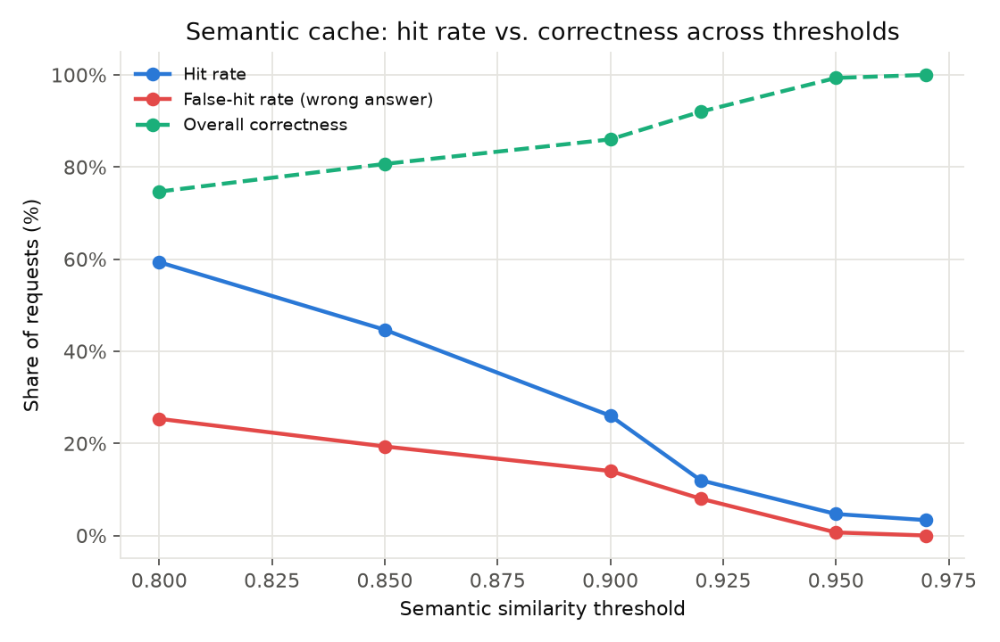

# ai-computation-cache

This repository investigates whether some AI workloads benefit more from
caching **reusable computation structure** than from caching **final
responses** — and, where they do, what that costs in terms of coverage
(how often reuse is even possible) versus what response caching gains in
correctness risk.

It is a controlled engineering investigation, not a product and not a
paper claiming a new technique. See `docs/prior-art.md` for what's
established prior art (exact caching, semantic caching, plan caching,
cost-aware eviction) versus what this repo actually tests (one specific
combination of representation, identification, binding, and validation,
on a narrow, deterministic workload family).

## Problem

Exact-match caching only reuses byte-identical requests. Semantic
caching relaxes that to "similar enough" requests — which is unsafe when
a request's *answer* depends on parameters that vary independently of
its *wording*:

```
"What is X + Y?"        X=10,  Y=20   -> 30
"Calculate X plus Y."   X=51,  Y=93   -> 144
"Can you sum X and Y?"  X=712, Y=381  -> 1093
```

These three requests are near-identical in wording and completely
different in answer. What's stable across them isn't the response —
it's the computational structure, `ADD(x, y)`. Full write-up:
`docs/problem.md`.

## Hypothesis

> Some AI workloads may benefit more from caching reusable computation
> structure than from caching final responses, when parameters vary but
> structure doesn't.

Tested via eight falsifiable sub-hypotheses (H1–H8) — see
`docs/hypotheses.md` for each one's actual outcome against this repo's
own experiment.

## Architecture

Four conditions run over the same workload with the same LLM backend
(full detail: `docs/architecture.md`):

```
A. No cache          Request -> LLM -> Answer
B. Exact cache        Request -> exact match? -> cached answer : (LLM -> store)
C. Semantic cache      Request -> embed -> nearest neighbor above threshold?
                              -> cached answer : (LLM -> store)
D. Computation cache   Request -> identify task -> retrieve computation
                              -> extract + bind parameters -> validate
                              -> valid? execute directly : fall back to LLM
```

Scope: **Level 1 (deterministic arithmetic) and Level 2 (parameterized
business formulas) only** — closed-form, deterministic tasks, which is
what makes "reuse the procedure, rebind fresh parameters, execute
directly" a coherent design. Level 3 (database-backed workflows) and
Level 4 (agent workflows) need a different computation representation
and are explicitly out of scope for this prototype — see
`docs/architecture.md`'s scope note.

## Experimental setup

- Workload: 9 canonical tasks (`add`, `subtract`, `multiply`,
  `percentage`, `compound_interest`, `revenue`, `discounted_price`,
  `tax`, `margin`), each with several paraphrase templates and randomized
  parameters. 150 requests by default, fully seeded and reproducible
  (`workloads/generators.py`).
- LLM backend: a **simulated** backend by default (deterministic,
  offline, zero cost — see `aicache/llm/simulated.py` for exactly what's
  real (token-count heuristic, published pricing) vs. synthetic (latency
  distribution) about it) and a pluggable, real **Gemini** backend
  (`aicache/llm/gemini.py`, inactive unless `GEMINI_API_KEY` is set).
- Embedding model: `sentence-transformers/all-MiniLM-L6-v2`, CPU only.
- Metrics: hit/valid-hit/invalid-hit/miss/fallback rates, correctness
  (checked independently against ground truth, not assumed from
  outcome), tokens, cost, latency — see `docs/evaluation.md`.

Run it:

```
pip install -e .
python -m pytest tests/ -q                    # 48 tests
python -m benchmarks.run_experiment           # writes results/results.csv, results/summary.json
python -m benchmarks.plots                    # writes results/*.png
```

## Results

From the run documented in full in `docs/experiment-log.md` (EXP-004;
150 requests, seed 42, simulated backend):

| Baseline | Hit rate | Valid | Invalid | Correctness | Tokens | Cost (USD) |
|---|---|---|---|---|---|---|
| A — No cache | 0.0% | — | — | 100.0% | 2193 | 0.00338 |
| B — Exact cache | 0.0% | 0.0% | 0.0% | 100.0% | 2193 | 0.00338 |
| C — Semantic cache (threshold 0.75) | 72.7% | 36.7% | **36.0%** | **64.0%** | 527 | 0.00085 |
| D — Computation cache | 50.0% | 50.0% | **0.0%** | **100.0%** | 749 | 0.00134 |


The semantic-cache threshold sweep (0.80 → 0.97) shows this isn't a
tuning problem: correctness only approaches 100% once the hit rate has
collapsed to ~3–5%, and no threshold in the swept range beats the
computation cache's (50% hit, 100% correct) point on both axes at once.



**Headline finding**: on this workload, semantic response caching's
higher raw hit rate (72.7% vs. 50.0%) is not the better outcome once
correctness is accounted for — more than a third of its "hits" served a
wrong answer, silently. The computation cache traded some coverage
(50% fallback rate, by design, whenever task identification or parameter
binding couldn't be validated) for zero observed invalid hits. Full
numbers, the threshold sweep, and interpretation: `docs/experiment-log.md`.
All four remaining charts (`tokens_and_cost_by_baseline.png`,
`latency_by_baseline.png`) are in `results/`.

## Limitations

- **Single run, single seed** — no repeated-runs variance or confidence
  intervals are reported. See `docs/evaluation.md`.
- **Deterministic tasks only** — the computation cache's zero-invalid-hit
  result depends entirely on Level 1/2 tasks being closed-form and
  side-effect-free. It does not generalize to Level 3/4 without a
  different representation.
- **Positional parameter extraction** — a real, documented limitation
  (`aicache/binding/extractor.py`); two template bugs exploiting exactly
  this limitation were found and fixed during development (see
  `docs/experiment-log.md`, EXP-002/EXP-003) — not swept under the rug.
- **Task-identification threshold is a real, unresolved trade-off** — see
  H6 in `docs/hypotheses.md`: similarity magnitude doesn't monotonically
  separate correct from incorrect task matches for this embedding model
  on terse arithmetic phrasings.
- **Simulated backend by default** — see `aicache/llm/simulated.py` for
  exactly what's real vs. synthetic about its numbers. A real-backend
  validation run is listed as follow-up work in `docs/experiment-log.md`,
  not claimed to have been done.
- **No eviction/admission policy of any kind** — see
  `docs/eviction-future-work.md`; explicitly deferred, not solved.

## Prior art

`docs/prior-art.md` — Redis/LangCache, GPTCache, vLLM prefix caching,
LMCache, Agentic Plan Caching, Google PARROT, TinyLFU/W-TinyLFU,
CacheLib, and others, mapped against this repo's own design choices.
Nothing in this repo claims to invent computation caching, semantic
caching, or cost-aware eviction.

## Future work

See `docs/eviction-future-work.md` (admission/eviction at real scale)
and the "Next experiments" list at the end of `docs/experiment-log.md`
(workload-repetition sweep, identification-threshold sweep, real-backend
validation, Level 3 prototype, hierarchical/combined baseline).

## Repository layout

```
ai-computation-cache/
├── docs/            problem, prior-art, architecture, hypotheses,
│                    evaluation, eviction-future-work, experiment-log
├── src/aicache/     the library: cache/, semantic/matching/, computation/,
│                    binding/, validation/, metrics/, llm/
├── workloads/       Level 1/2 workload generator + paraphrase templates
├── benchmarks/      baselines.py, run_experiment.py, plots.py
├── tests/           48 unit + integration tests
├── results/         results.csv, summary.json, generated charts
└── configs/         (reserved for future experiment configs)
```
