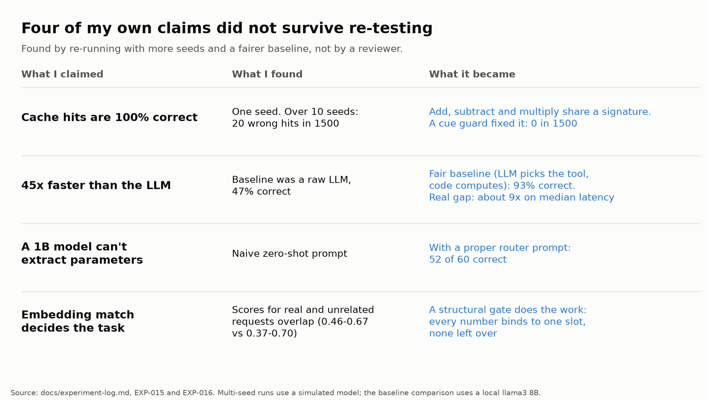

# aicache

**Answer the calculation-shaped requests in your LLM app with your own code. Send everything else to the model.**

Some LLM requests are really calculations: a percentage, a price after a discount, a position size. A model answers them slowly and sometimes wrongly. aicache lets you register the function that computes the answer, and uses it only when it can bind every number in the request safely. Anything it is not sure about goes to your model, unchanged.

```
"What is 15% of 240?"                    -> computed locally, in tens of milliseconds: 36.00
"Of 240, what is 15 percent?"            -> computed locally: 36.00
"What is 15% of that?"                   -> refused, sent to the model
"What does percent mean?"                -> refused, sent to the model
```

It never guesses. A request is computed only if every number in it is claimed by exactly one parameter and every parameter has a number.

**Status: alpha (0.2).** The core idea is measured and documented, including where it fails. The API may change. See [Limits](#limits).

- [Install](#install)
- [Quickstart](#quickstart)
- [What you get](#what-you-get)
- [Evidence](#evidence)
- [Limits](#limits)
- [Guides](#guides)
- [Research behind it](#research-behind-it)
- [Reproduce](#reproduce)

## Install

```bash
pip install "ai-computation-cache[embeddings,serve]"
```

The core install is small (about 77 MB, no torch). Optional extras:

| Extra | Adds |
|---|---|
| `embeddings` | local embedding model (the default embedder) |
| `serve` | `aicache serve`, the OpenAI-compatible gateway |
| `langchain` | `aicache.integrations.langchain` |
| `research` | what the benchmarks and plots need |

Without `embeddings`, use `embedder: {type: hashing}` (no download) or `type: openai` (any `/v1/embeddings` server).

## Quickstart

```bash
aicache init aicache.yaml        # a starter config with one tool
aicache validate aicache.yaml    # check it and lint it
aicache test aicache.yaml        # run the golden tests inside the config
aicache run aicache.yaml "What is 15% of 240?"
```

A tool is declared in YAML. No code needed for arithmetic:

```yaml
tools:
  - name: percent_of
    examples: ["What is X percent of Y?", "Calculate X% of Y.", "How much is X percent of the amount Y?"]
    slots:
      - {name: pct,  after: "%|percent", min: 0, max: 100}   # where each number sits in the sentence
      - {name: base, before: "of"}
    compute: "base * pct / 100"                              # a safe expression, never eval
    format: "{value:.2f}"
    tests:
      - {text: "What is 15% of 240?", expect: 36}
      - {text: "What is 15% of that?", expect: refuse}
```

Use it in front of any OpenAI-compatible model. Your app only changes its base URL:

```yaml
upstream: {base_url: http://localhost:11434/v1, model: llama3}   # OpenAI, Ollama, vLLM, ...
```

```bash
aicache serve aicache.yaml --port 8080
```

```python
from openai import OpenAI
client = OpenAI(base_url="http://localhost:8080/v1", api_key="anything")
client.chat.completions.create(model="m", messages=[{"role": "user", "content": "What is 15% of 240?"}])
```

Or call the router from Python:

```python
from aicache.config import build_router, load_config

router = build_router(load_config("aicache.yaml"))
result = router.run("What is 15% of 240?", fallback=ask_my_llm)
result.source   # "computation" or "fallback"
```

A longer example with five finance tools is in [examples/finance_tools.yaml](examples/finance_tools.yaml). Full walkthrough: [docs/guide/quickstart.md](docs/guide/quickstart.md).

## What you get

| | |
|---|---|
| **Declarative tools** | Define tools in YAML. Safe arithmetic expressions, or your own Python function. Validation lists every config problem at once. |
| **A strict safety gate** | Every number must bind to exactly one parameter, with none left over. Order in the sentence does not matter. Ambiguous or incomplete requests are refused. |
| **Golden tests in the config** | `aicache test` runs requests that must compute and requests that must be refused. |
| **A linter** | Warns about thin examples, missing tests, and same-shaped tools without `cues`, the setup that caused wrong answers in our benchmark. |
| **Measure before you trust** | `aicache eval` counts wrong executions on your labeled requests and exits non-zero if there are any, so it can gate CI. `aicache calibrate` picks the similarity threshold. |
| **Safe rollout** | Per-tool `active`, `shadow` or `off`. Shadow mode computes but lets the model answer, and records whether they agree. A runtime kill switch turns a tool off without a restart. |
| **An OpenAI-compatible gateway** | Streaming, client auth, admin endpoints, request-size and text-length limits. Requests that use tools, structured output or images pass straight through. |
| **Observability** | Prometheus metrics, a JSONL decision log, `aicache stats`. Request text is not stored unless you turn it on. |
| **Pluggable embeddings** | Local model, any OpenAI-compatible server, or a dependency-free hashing embedder. |
| **Frameworks** | A LangChain / LangGraph runnable. A plain Python API with sync and async. |
| **Packaging** | Light install, a console command, a Docker image, a CI workflow, type hints included. |

## Evidence

What was measured, with the caveats that go with it. Every number below comes from [docs/experiment-log.md](docs/experiment-log.md) and can be reproduced.

**Safety gate, 131 labeled finance requests** (EXP-018, real embedding model, real local LLM behind the gateway): 90 of 96 computable requests were computed correctly, 0 wrong answers, and 0 of 35 requests that should be refused were computed. The other 6 were refused and answered by the model. The 95% upper bound on the bad-execution rate is about 3%, which is what 131 requests can show. In `aicache calibrate` on the same set there were no wrong answers and no false triggers at any similarity threshold from 0 to 0.95. Coverage held above 93% up to 0.45 and then fell. So the binding step, not similarity, does the rejecting.

**Speed** (same run): requests the tools answered had a median of 88 ms. Requests the gateway forwarded had a median of 4.4 s, about 224 ms slower than calling the model directly, which is the embedding, one proxy hop and noise, on one laptop shared with the model. How much a deployment gains depends on how many requests are computable and how long its model replies take.

**Against a fair baseline** (EXP-015, 150 requests, local Llama 3 8B at temperature 0): the fair baseline is an LLM that picks the tool and parameters while code does the math. It scored 93% at 1.2 s median. Computation first with that router as the fallback scored 97% at 129 ms median. The accuracy difference is not conclusive at this sample size. Median latency was about 9x lower and 77% of requests needed no model call. Against a model answering directly the gap looks far larger (47% correct), but that is a weak baseline, and an earlier "45x" claim in this project's history was measured against it and has been withdrawn.


**Where it failed, and what it taught us.** The first cache made 20 wrong hits in 1,500 requests across 10 seeds, because tools that differ only by operation (add, subtract) were confused by embeddings. A `cues` guard brought that to 0 in 1,500. A second tool, on a real open-source finance app's risk tools, showed an LLM router silently turning "0.5%" into 0.005, a position size 100x too small with no error. The structured gate avoided that class of error by refusing instead.



## Limits

- **Templated phrasings, not real traffic.** The evidence uses generated phrasings. The example config's slots were tuned after seeing failures on development phrasings, so coverage there is optimistic. Phrasings the slots do not describe are refused, not guessed, and cost you the model call.
- **One 8B model, one laptop.** A stronger model narrows the accuracy gap. Latency depends on your hardware.
- **You write the slots.** A tool is only as safe as its slots and tests. Measure wrong executions on your own requests before going active. Shadow mode exists for this.
- **Numbers and keywords only.** It does not understand meaning. Units are your responsibility: a formula that expects a fraction but gets "0.5%" gives a wrong answer without an error.
- **Not for side effects or judgment.** Keep tools pure and based only on the request text.
- **The gateway is one process.** Counters are in memory, per process, and it does not terminate TLS.
- **The older arithmetic validator** in the research code still cannot catch out-of-order numbers. The router's binding does.
- **Streaming fallbacks** are relayed but not compared in shadow mode.
- Alpha: expect API changes. The research results (EXP-001 to EXP-014) are single-seed; later entries supersede them where they disagree.

## Guides

- [Quickstart](docs/guide/quickstart.md)
- [Config reference](docs/guide/config-reference.md)
- [How a request is decided](docs/guide/how-it-decides.md), including known failure patterns
- [Rolling it out safely](docs/guide/rollout.md): tests, eval, calibration, shadow mode, kill switch
- [The gateway](docs/guide/gateway.md): endpoints, auth, metrics, Docker
- [Integrations](docs/guide/integrations.md): Python, LangChain, bring your own tool
- [Changelog](CHANGELOG.md), [Security](SECURITY.md), [Contributing](CONTRIBUTING.md)

## Research behind it

The product grew out of a controlled investigation: for requests whose answers depend on parameters, is it better to cache the computation than the answer? A semantic cache treats "What is 10 + 20?" and "What is 712 + 381?" as nearly the same sentence and can serve the wrong one with full confidence. A bank's production semantic cache matched "I don't want this card anymore" to investment account closure at 88.7% confidence (Daivam, InfoQ, 2025).

This is not a new technique. Plan caching and structured-intent caching exist: Zhang, Wornow, Wan and Olukotun, [Agentic Plan Caching](https://arxiv.org/abs/2506.14852), which reports 50.31% lower cost and 27.28% lower latency in its current abstract; Basu, [Structured Intent Canonicalization](https://arxiv.org/abs/2602.18922). The full map of 17 systems is in [docs/prior-art.md](docs/prior-art.md). What the project adds is a controlled comparison of one combination, identify then bind then validate then fall back, with the failures reported.

18 logged experiments across four workload levels, with real GPTCache and RedisVL as baselines:


- A good semantic cache stayed about 99% correct on plain arithmetic, but when no request repeats an earlier request's exact numbers it served 0% from cache and the computation cache about 75%. When numbers repeat often, the two get close. If your parameters repeat, you may not need this.
- Over 10 seeds on database-backed and branching workflows the computation cache made 1 wrong hit in 2,250 requests and 0 in 1,800. The semantic cache, at the harness's looser 0.65 threshold, was 64% and 38% correct.
- The research docs are in [docs/](docs/); the code is in `src/aicache/` and `benchmarks/`.

## Reproduce

```bash
pip install -e ".[dev]"

bash scripts/reproduce.sh quick       # 231 tests + the wrong-hit guard comparison, about 5 minutes, offline
bash scripts/reproduce.sh sweep       # repeat-rate sweep and figure 2, about 15 minutes, offline
bash scripts/reproduce.sh realmodel   # fair-baseline comparison, needs Ollama and llama3
bash scripts/reproduce.sh realapp     # financial-chat integration, needs Ollama, llama3 and network
python -m benchmarks.gateway_e2e      # the gateway end to end in front of Ollama, about 15 minutes
```

| Claim | How to check |
|---|---|
| 20 wrong hits in 1,500 without the guard, 0 with it | `python -m benchmarks.guard_ab` |
| Gateway end to end | `python -m benchmarks.gateway_e2e`, committed copy `results/gateway_e2e.json` |
| Safety gate on labeled requests | `aicache eval examples/finance_tools.yaml --labeled examples/finance_labeled.jsonl` |
| Fair-baseline accuracy and latency | `bash scripts/reproduce.sh realmodel`, committed copy `results/real_baselines/` |
| Financial-chat comparison | `bash scripts/reproduce.sh realapp`, committed copy `results/real_app_financial_chat.json` |
| Level 3 and 4 across 10 seeds | raw summaries in `results/sweeps/level34/`, protocol in EXP-017 |

Everything writes to `out/` and never overwrites the committed `results/`. Latency depends on your hardware and on whatever else is using it: expect the same ordering, not the same milliseconds. Model sampling is pinned, but a different Ollama or model build can still change individual answers.

## Repository layout

```
src/aicache/  router.py, config.py, server.py, cli.py, tooling.py, safe_expr.py,
              embedders.py, telemetry.py, integrations/   the product
              cache/, matching/, computation/, binding/, ...   the research code
docs/         guide/ (user guides), experiment-log.md, prior-art.md, research notes
examples/     finance_tools.yaml, finance_labeled.jsonl, position_size_router.py
benchmarks/   research and end-to-end benchmarks
tests/        231 tests
results/      committed raw results and figures
scripts/      reproduce.sh
```

## License

MIT. See [LICENSE](LICENSE).
