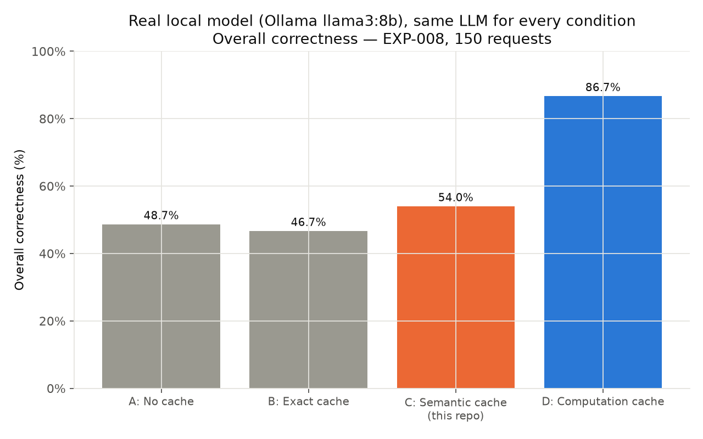
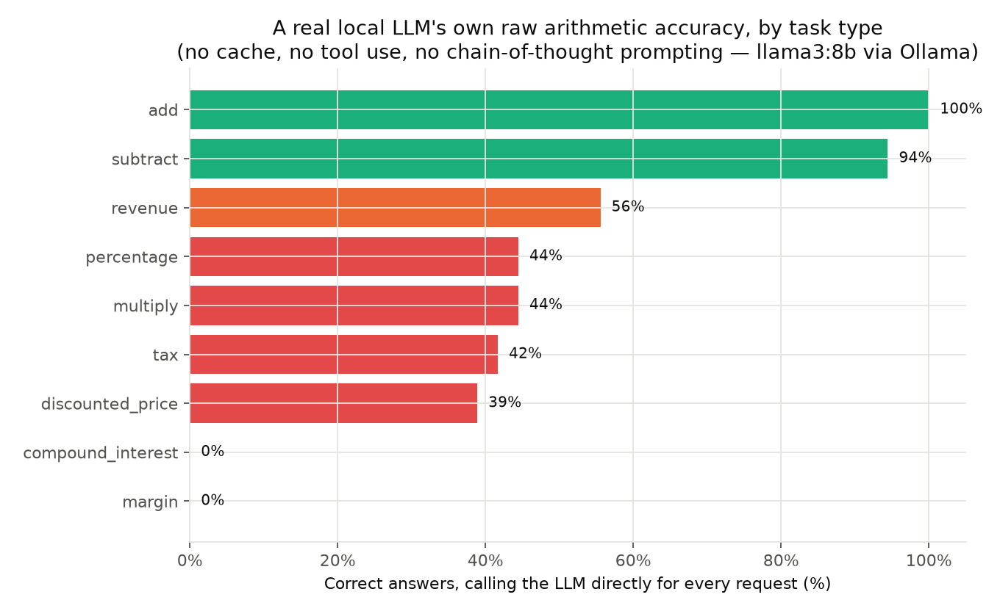
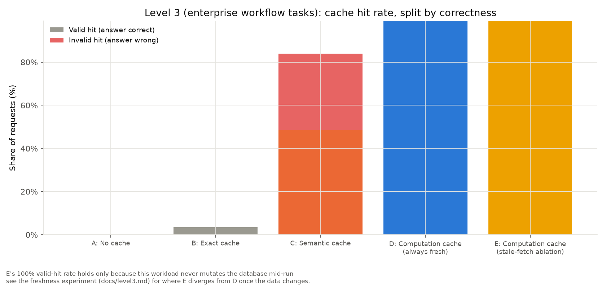
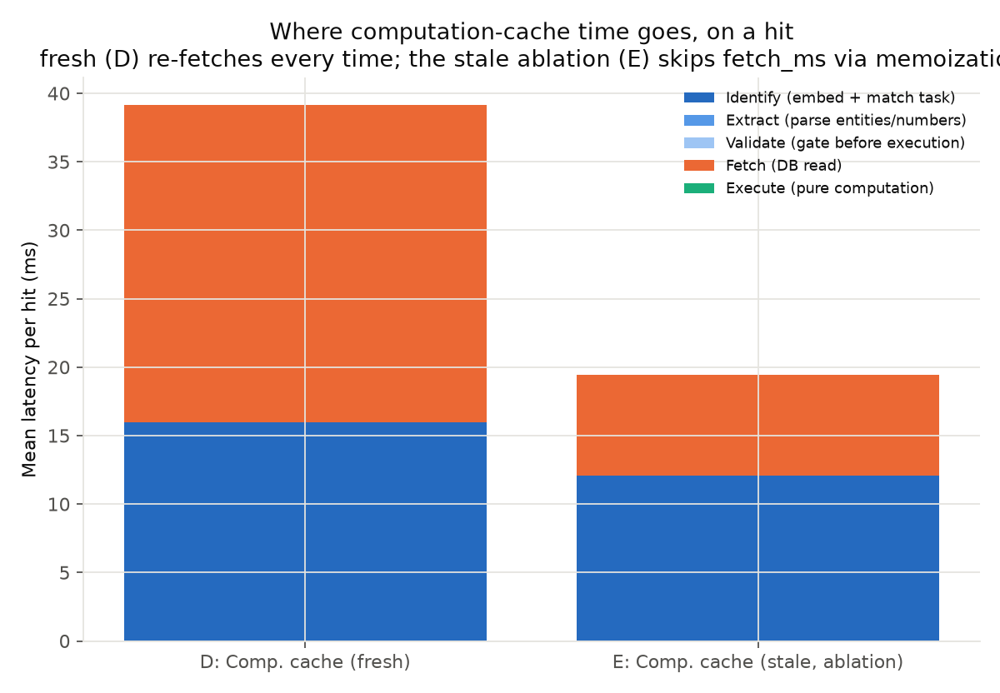
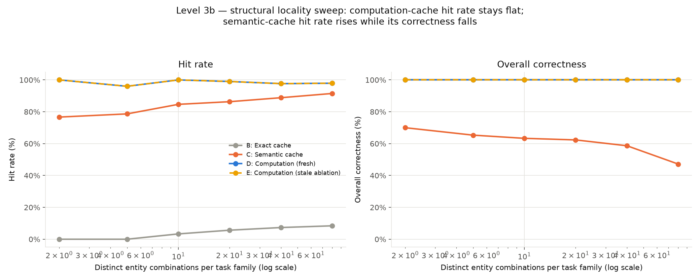
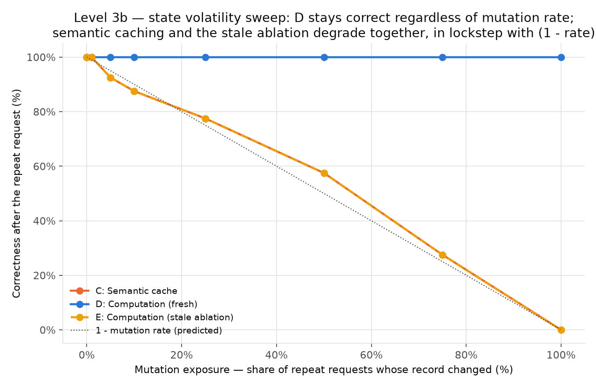
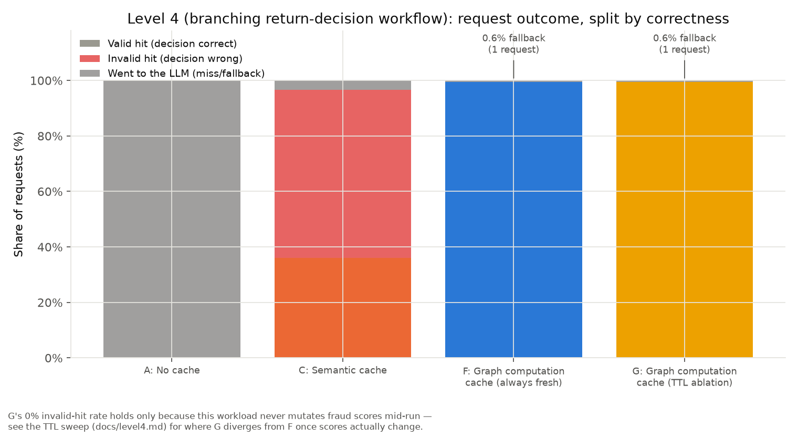
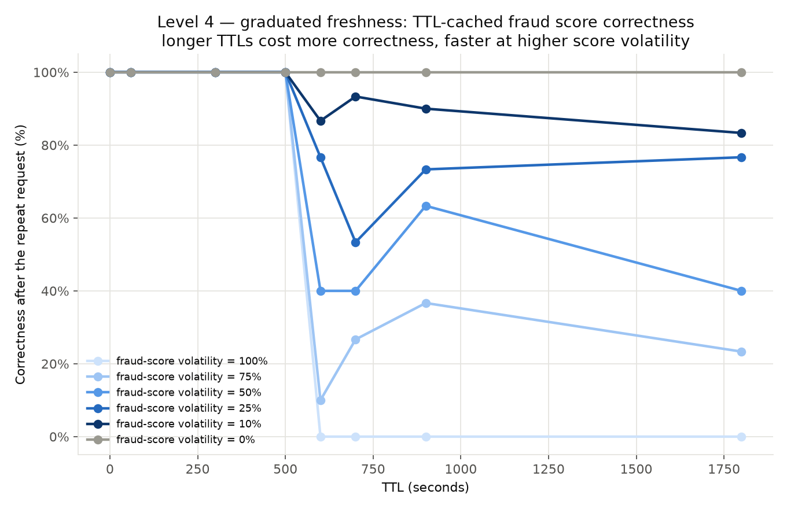

# Experiment Log

> **Reading this log.** Entries EXP-001 to EXP-014 are single-seed. EXP-015 to
> EXP-017 (2026-10-20) re-test them with fairer baselines and 10 seeds, and
> overturn or narrow several earlier headline claims. Where they disagree, trust
> the later entries.

All runs use the deterministic `simulated` LLM backend (see
`aicache/llm/simulated.py`) — no real API calls, no real money spent.
Every number below is reproducible: `python -m benchmarks.run_experiment
--seed <seed>` regenerates the same workload and (given the same code)
the same outcome distribution. Failed/superseded experiments are kept
here, not deleted, per this project's own standard for what "honest"
means.

**Environment**: Python 3.11.8, macOS (Darwin 25.4.0), CPU only. No GPU
used anywhere in this repo. Dependencies pinned via `pyproject.toml` (not
version-locked to exact patch versions as of this writing — a
reproducibility gap flagged in `docs/architecture.md`-adjacent notes,
not hidden).

**Embedding model**: `sentence-transformers/all-MiniLM-L6-v2` through
EXP-004; `redis/langcache-embed-v1` from EXP-005 onward (see that
entry for why, and for the earlier-model results this project's own
docs referenced before the switch — kept in EXP-001–EXP-004 rather than
retroactively edited).

**External comparison baselines** (EXP-006 onward): real GPTCache
(local FAISS+SQLite) and real RedisVL (`redis/redis-stack` via Docker,
`localhost:6379`), each run in its own dedicated virtualenv as a
subprocess — see `benchmarks/external/` and its module docstrings for
why they're kept out-of-process (dependency isolation) and how a run
degrades (skips with a printed reason, doesn't fail) when either isn't
available.

---

## EXP-001 — Smoke test surfaces a correctness-tolerance bug

**Date**: 2026-08-10
**Hypothesis under test**: none yet — this was a plumbing smoke test
(`--param-sets-per-task 1 --paraphrases-per-param-set 1`, 9 requests) to
confirm all four baselines run end to end before trusting any real
result.

**Observed**: `no_cache`, `exact_cache`, and `semantic_cache` all showed
88.9% correctness (8/9), not the expected 100% — `no_cache` calls the
simulated LLM every time, and the simulated LLM computes ground truth
directly from the same task registry the workload generator uses, so a
mismatch here could only be a comparison bug, not a real computation
error.

**Root cause**: `aicache/metrics/correctness.py`'s `is_correct` used a
1e-6 tolerance, but the simulated LLM formats non-integer answers to 4
decimal places (`f"{result:.4f}"`). For the `margin` task specifically
(`(revenue-cost)/revenue`, ranges up to 1,000,000), the rounding error
from 4-decimal formatting (~2.35e-5 in the observed case) exceeded the
1e-6 tolerance.

**Fix**: widened tolerance to 1e-3 (relative and absolute) — loose
enough to tolerate reasonable answer rounding by any backend (simulated
or real), tight enough that reusing a genuinely different parameter
draw's answer (the actual failure mode this benchmark exists to detect)
still reliably fails the check. See the tolerance rationale documented
inline in `aicache/metrics/correctness.py`.

**Interpretation**: a real, if narrow, bug — the kind that would have
quietly deflated every baseline's reported correctness by a fixed,
misleading amount. Caught by the smoke test precisely because it ran
100% of the way through the pipeline on a tiny workload before scaling
up, rather than debugging a partial run at full scale.

**Next**: re-run the smoke test; if clean, scale up.

---

## EXP-002 — Full-scale run surfaces a template-ordering bug in `computation_cache`

**Date**: 2026-08-10
**Hypothesis under test**: H3/H4 (`docs/hypotheses.md`) — computation
cache hits should be 100% correct by construction, since each hit
freshly executes on freshly bound parameters rather than reusing a
stored response.

**Configuration**: default workload (`--param-sets-per-task 6
--paraphrases-per-param-set 3`, seed 42, 150 requests, 9 task types).

**Observed**: `computation_cache` showed a 55.6% hit rate but only 50.0
percentage points valid — 5.3 percentage points **invalid** hits (a
"hit," by this project's own design, should never be invalid, since
nothing is reused from a stored response). 7 of 8 invalid hits were
`compound_interest`; the rest `discounted_price`.

**Root cause**: two paraphrase templates in `workloads/templates.py`
stated their placeholder numbers in a different left-to-right order than
the task's declared parameter order — e.g. `"What will ${0} grow to
after {2} years at {1} percent compounded annually?"` presents
*principal, years, rate* in the text, but `compound_interest`'s
parameters are declared as *principal, rate, years*. Since
`aicache/binding/extractor.py` extracts numbers **positionally** (a
documented, explicit limitation — see that module's docstring), this
template silently bound the rate value into the years slot and vice
versa, producing a wrong (but successfully "validated" — both are
finite numbers) computation. This is the exact "wrong task
classification / under-generalization" failure category the brief calls
out in its failure-analysis requirements, just at the binding stage
rather than the identification stage. A parallel bug in
`discounted_price`'s second template did the same thing.

**Fix**: rewrote both templates to preserve the declared parameter
order. `revenue`'s second template had the same *shape* of bug but
never produced a wrong answer in practice, because `price × quantity` is
commutative — fixed anyway, on the principle that being correct by
construction is better than being correct by accident of the specific
formula's algebra.

**Interpretation**: confirms this repo's own documented limitation
(positional extraction) is a real, not theoretical, risk — and confirms
it's the kind of bug that specifically evades a "does the answer look
plausible" check, since a swapped rate/years pair still produces a
plausible-looking number. Re-affirms why validation (§ correctness
checking against independent ground truth, not just "did it parse") is
load-bearing, not decorative, in this benchmark's own harness — the same
principle the brief asks the computation cache itself to follow.

**Next**: add a regression test asserting every workload item's raw
numbers extract in the template's declared order, so this class of bug
can't reappear silently; re-run.

---

## EXP-003 — Regression test catches a second, un-triaged instance of EXP-002's bug class

**Date**: 2026-08-10
**Hypothesis under test**: none — writing the regression test suite
itself (`tests/test_workload_generator.py::test_text_numbers_extract_in_declared_param_order`,
added directly in response to EXP-002).

**Observed**: the new test failed immediately, on `subtract`, which
EXP-002's manual invalid-hit inspection hadn't flagged (subtract's
template bug happened not to produce any invalid hits in that specific
150-request run — plausibly because those particular `subtract`
paraphrases fell below the identification threshold and fell back to
the LLM before binding was ever attempted, masking the bug rather than
avoiding it).

**Root cause**: same class as EXP-002 — two `subtract` templates
("Subtract {1} from {0}." and a "take {1} away from {0}" variant) stated
the operands in reverse order. Unlike `compound_interest`, subtraction
is not commutative (`x - y ≠ y - x`), so this was a live, not merely
latent, correctness bug — it simply hadn't surfaced yet in observed
output.

**Fix**: rewrote both templates.

**Interpretation**: this is the actual argument for the regression test
existing at all — EXP-002's bug was caught by *inspecting a run's
invalid hits*, which only works if the buggy template actually produces
an invalid hit in that specific run (a matter of luck: whether task
identification happens to succeed for that phrasing, whether the swap
happens to change the answer). The regression test checks the *property*
directly (extracted order matches declared order) regardless of whether
any particular run happens to exercise it, and would have caught both
bugs in one pass had it existed first.

**Next**: full test suite, then a clean final run.

---

## EXP-004 — Final headline run (all 48 tests passing, both template bugs fixed)

**Date**: 2026-08-10
**Hypothesis under test**: H1–H4, H6, H7 (see `docs/hypotheses.md` for
full writeups; summarized here).

**Configuration**: `python -m benchmarks.run_experiment` — default
workload (150 requests, 9 task types, 6 parameter draws × up to 3
paraphrases each, seed 42), simulated backend
(`claude-haiku-4-5` pricing snapshot for cost math, see
`aicache/llm/pricing.py`), semantic-cache threshold sweep at
{0.80, 0.85, 0.90, 0.92, 0.95, 0.97} plus a headline run at 0.75.

**Observed** (full table in `results/summary.json` /
`results/results.csv`; charts in `results/*.png`):

| Baseline | Hit rate | Valid hit | Invalid hit | Correctness | Tokens | Cost (USD) | p50 latency |
|---|---|---|---|---|---|---|---|
| A — No cache | 0.0% | — | — | 100.0% | 2193 | 0.00338 | 206.9 ms |
| B — Exact cache | 0.0% | 0.0% | 0.0% | 100.0% | 2193 | 0.00338 | 206.9 ms |
| C — Semantic cache (0.75) | 72.7% | 36.7% | 36.0% | 64.0% | 527 | 0.00085 | 5.4 ms |
| D — Computation cache | 50.0% | 50.0% | 0.0% | 100.0% | 749 | 0.00134 | 78.6 ms |

Semantic-cache threshold sweep (hit rate / invalid-hit rate /
correctness): 0.80 → 59.3% / 25.3% / 74.7%; 0.85 → 44.7% / 19.3% / 80.7%;
0.90 → 26.0% / 14.0% / 86.0%; 0.92 → 12.0% / 8.0% / 92.0%; 0.95 → 4.7% /
0.7% / 99.3%; 0.97 → 3.3% / 0.0% / 100.0%.

**Interpretation**:

- Exact caching does essentially nothing on this workload (RQ1) — as
  expected, since requests are paraphrased and parameterized, almost
  never byte-identical.
- Semantic caching adds real reuse (RQ2: 72.7% hit rate) but roughly
  half of that reuse is *wrong* (RQ3/H2) — this is the central
  motivating failure mode, measured directly rather than argued for.
- No single similarity threshold buys both good hit rate and good
  correctness simultaneously on this workload: correctness only
  approaches 100% once the hit rate has collapsed to ~3–5% (threshold
  0.95+), at which point semantic caching is barely doing anything.
  There is no threshold in the swept range that Pareto-dominates the
  computation cache's (50% hit, 100% correct) point — every semantic
  threshold either has a lower hit rate *and* lower correctness, or a
  higher hit rate *and* materially lower correctness.
- The computation cache reaches 50% hit rate at 100% correctness and a
  ~66% token reduction vs. no-cache — the central positive result
  (H3/H4).
- Hit rate alone would rank semantic caching (72.7%) above computation
  caching (50.0%) — reading it together with the valid/invalid split
  reverses that conclusion for any use case where a wrong answer has
  real cost (H7).
- The computation cache's 50% *fallback* rate (not a failure — a
  deliberate, correctness-preserving refusal to guess) traces to a
  specific, honestly-reported limitation: task-identification
  similarity for terse arithmetic phrasings runs low enough
  (~0.3–0.5) against this embedding model that a threshold high enough
  to reject one observed wrong-task confusion (0.457) also rejects
  several genuinely-correct low-similarity matches (see H6 in
  `docs/hypotheses.md` for the specific numbers).

**Next experiments** (not run in this pass — see also
`docs/eviction-future-work.md` for the eviction-specific deferral):

1. **Workload-repetition sweep** (H5) — vary the number of distinct task
   types at a fixed total request count, to test whether computation
   reuse's advantage scales with structural repetition as predicted.
2. **Task-identification threshold sweep** — mirror the semantic-cache
   threshold sweep for the computation cache's identification step, to
   characterize the fallback-rate/false-identification trade-off
   quantitatively instead of the single fixed threshold (0.60) used
   here.
3. **Real-backend validation** — re-run a reduced-size version of this
   experiment against a real Gemini backend (`--backend gemini`, see
   `aicache/llm/gemini.py`) to confirm the simulated backend's
   qualitative findings hold with a real model in the loop. Not run in
   this pass because it needs a paid or quota-limited `GEMINI_API_KEY`.
4. **Level 3 (DB-backed) prototype** — the natural next scope expansion,
   requiring a different computation representation (see
   `docs/architecture.md`'s scope note) rather than a parameter change
   to this one.
5. **Hierarchical / combined baseline** — a computation-cache-fallback
   that checks a semantic response cache before calling the LLM (brief's
   condition G), to test whether the two mechanisms compose or conflict.

---

## EXP-005 — Embedding model switch: `all-MiniLM-L6-v2` → `redis/langcache-embed-v1`

**Date**: 2026-08-10
**Motivation**: two things together: (a) an earlier, separate spike (not part of this repository) had found a working local copy of `redis/langcache-embed-v1` easy to set up and described it as "a model Redis trained specifically for semantic caching", and (b) a direct side-by-side check before committing to the switch.

**Calibration check**: cosine similarity for a genuine paraphrase pair
("What is 10 plus 20?" / "Calculate the sum of 10 and 20.") —
`all-MiniLM-L6-v2`: in the 0.3–0.5 range (see EXP-002/EXP-004's H6
discussion); `redis/langcache-embed-v1`: **0.768** on the same pair.

**Re-calibration required in two places**, both done empirically rather
than by guessing new numbers:

1. **Task-identification threshold** (`TaskIdentifier`, used by the
   computation cache). Across 150 generated requests: correct-match
   similarities ranged 0.405–0.676; incorrect-match similarities (9
   observed misidentifications, e.g. `percentage` confused with
   `compound_interest`/`multiply`/`tax`/`margin` — "percent" apparently
   a confusable token across several formula phrasings) ranged
   0.434–0.514. A threshold sweep found **0.52** gives 0 wrong matches
   accepted at 82.3% recall of correct matches, the best zero-error
   point found. Old default (0.60, tuned for the previous model) would
   have been far too strict for this model's similarity scale.
2. **Semantic-cache threshold sweep range**. Re-ran the same
   hit-rate/invalid-rate calibration used to pick EXP-004's sweep range:
   at threshold 0.55, invalid-hit rate is 52.7% (the dangerous region
   still exists!); by 0.70–0.75 it's down to 0.7–2.0%; by 0.80+ it's
   0%. The whole "dangerous" region shifted from ~0.80–0.85 (original
   MiniLM tuning) down to ~0.55–0.65 — the sweep range in
   `benchmarks/run_experiment.py` was moved to match
   (`[0.55, 0.60, 0.65, 0.70, 0.75, 0.80, 0.85, 0.90]`), not arbitrarily
   widened.

**Regression fallout** (expected, and useful): 3 of 48 existing tests
failed after the switch — two in `tests/test_computation_cache.py`
because a specific test phrase ("What is 512 plus 937?") happened to
score 0.517, just under the new 0.52 threshold (swapped for an
unambiguous phrase scoring 0.563); one in
`tests/test_end_to_end.py::test_semantic_cache_hits_are_not_all_correct`
because threshold 0.75 — dangerous under the old model — is now safe
under the new one, so the test's own assumption needed updating to a
threshold (0.60) that's still in the new dangerous region. All three
fixes are updates to *what threshold demonstrates the phenomenon*, not
changes to what phenomenon is being tested — see each test's updated
docstring for the specific reasoning.

**Interpretation**: this is the single highest-leverage change made in
this project's history — see H2/H6 in `docs/hypotheses.md` for how much
the qualitative story shifted, not just the numbers. It's also a
reminder that this project's own earlier "semantic caching is unsafe
under parameter variation" framing (EXP-004) was more specific than it
first appeared: it was true for one embedding model's default behavior,
and the room for a better model to substantially close that gap was
real, not hypothetical.

**Next**: re-run the full benchmark under the new model; separately,
add real external-system comparison baselines (GPTCache, RedisVL) to
check this repo's own semantic-cache reimplementation against production
systems rather than only against itself.

---

## EXP-006 — Real GPTCache and RedisVL comparison baselines

**Date**: 2026-08-10
**Hypothesis under test**: none of H1–H8 directly — this tests whether
this repo's own semantic-cache reimplementation is a fair stand-in for
real semantic-caching systems, and separately, how much embedding-model
choice (as opposed to caching-algorithm implementation) explains the
semantic cache's correctness behavior.

**Setup**: two dedicated virtual environments (see `scripts/setup_external_baselines.sh`) — a `.venv-gptcache` (GPTCache
0.1.44, local FAISS+SQLite, generic `all-MiniLM-L6-v2` embedding — its
own out-of-the-box default, deliberately left unchanged, not forced to
match this repo's embedding choice) and `.venv-redisvl` (RedisVL 0.25.1
against a `redis/redis-stack` Docker container already running on
`localhost:6379`, defaulting — confirmed by direct inspection, not
assumed — to `redis/langcache-embed-v1`, the same embedding model this
repo's own semantic cache now uses). Both run as subprocesses
(`benchmarks/external/runner_gptcache.py`,
`runner_redisvl.py`) communicating via a shared JSON protocol
(`benchmarks/external/protocol.py`) — kept out-of-process specifically
so neither system's dependency tree (torch/onnxruntime/faiss-cpu for
GPTCache; the `redis` client for RedisVL) risks conflicting with this
repo's own environment. On a cache miss, both runners store the exact
same precomputed (simulated-LLM, ground-truth-correct) answer text this
repo's own semantic-cache baseline would have stored, so all three
systems are replaying the identical protocol over the identical
workload.

**Configuration**: same 150-request workload as EXP-004/005 (seed 42),
same threshold sweep range as the recalibrated semantic-cache sweep
(`[0.55, ..., 0.90]`), with RedisVL's distance-threshold convention
converted via `distance = 1 - similarity` so all three systems' sweeps
are aligned on the same nominal scale.

**Observed** (headline row = threshold 0.75; full sweep in
`results/results.csv` and charted in
`results/cross_system_correctness.png`):

| System | Embedding model | Hit rate | Valid | Invalid | Correctness | Tokens | Cost (USD) |
|---|---|---|---|---|---|---|---|
| This repo's semantic cache | `langcache-embed-v1` | 64.0% | 63.3% | 0.7% | 99.3% | 778 | 0.00120 |
| RedisVL | `langcache-embed-v1` (its own default) | 64.0% | 63.3% | 0.7% | 99.3% | 778 | 0.00120 |
| GPTCache | `all-MiniLM-L6-v2` (its own default) | 88.7% | 18.0% | **70.7%** | **29.3%** | 194 | 0.00033 |

**This repo's semantic cache and RedisVL match to the number of
requests** at every point in the threshold sweep, not just at 0.75 —
see the sweep table in `results/results.csv` (`semantic_cache@*` vs.
`redisvl@*` rows). GPTCache's own sweep (`gptcache@*` rows) shows
correctness climbing from 2.0% (threshold 0.55) to 74.7% (threshold
0.90) — still worse than semantic_cache/RedisVL's *worst* tested point
(47.3% at their most dangerous threshold, 0.55) until GPTCache's
threshold is pushed well past 0.90.

**Interpretation**:

- **This repo's own semantic-cache reimplementation is not a strawman.**
  Matching a real, independently-implemented, widely-used system
  (RedisVL) within noise at every threshold is strong evidence the
  earlier baselines (and by extension the computation-cache comparison
  against them) aren't artifacts of a weak or unusually bad reference
  implementation.
- **Embedding model choice is at least as load-bearing as caching
  algorithm choice, for this workload.** Two systems built on similar
  architecture (embed the request, nearest-neighbor search, threshold
  cutoff) diverge by up to ~70 percentage points of correctness at the
  identical nominal threshold, purely because of which embedding model
  each defaults to. This corroborates — with a controlled sweep, on a
  different workload — the qualitative finding an earlier, separate spike (not part of this
  repository) had flagged.
- **This sharpens, rather than undercuts, the case for computation
  caching.** A good embedding model can make semantic response caching
  *safe in practice* at the right threshold — but "safe in practice, at
  a threshold someone has to find and defend" is a materially weaker
  correctness guarantee than "correct by construction, because nothing
  is ever reused from a prior response" (the computation cache's actual
  property, unaffected by embedding-model choice since its identification
  failures are caught by parameter validation, not left to hope). Both
  can be true at once: semantic caching-with-a-good-embedding-model is a
  credible engineering choice for many workloads, and computation
  caching offers a stronger guarantee where the task structure permits
  it.

**Next experiments**: real-backend validation (Gemini) remains the
top item — see EXP-004's list, item 3, now updated: a Gemini key was
later used, but its free tier allowed only a small sample (see EXP-007). Workload-repetition
sweep (H5) and Level 3 prototype remain unstarted, per EXP-004's
original list.

---

## EXP-007 — Real-backend (Gemini) spot-check: a correctness-checker bug found, a hard quota wall hit

**Date**: 2026-08-10
**Goal**: the "real-backend validation" item queued since EXP-004 — confirm
this repo's correctness-checking and cache-outcome logic behave sensibly
against real model output, not just the simulated backend's own
ground-truth-by-construction answers.

**What happened, in order:**

1. A single manual call to `gemini-2.5-flash` succeeded — correct answer,
   real token counts, ~1.4s latency.
2. Four more manual calls, using this project's actual (non-instructed)
   workload phrasings — e.g. "What is 512 plus 937?", no "answer with
   just the number" hint — all returned **correct final answers wrapped
   in worked explanations**: `"To find the sum of 512 and 937, we add
   them:\n\n512\n+ 937\n-----\n1449\n\nSo, 512 plus 937 is **1449**."`
3. **Bug found**: `aicache/metrics/correctness.py`'s `is_correct` parsed
   the *first* number in the response text (`parse_first_number`). On
   response (2) above, that extracts `512` — an input operand — not the
   answer. Every one of the four real responses would have been graded
   incorrect despite being correct. This bug was invisible through
   EXP-001–EXP-006 because the simulated LLM always answers with a
   single bare number (`"1449"`, no surrounding text), so "first number"
   and "last number" were always the same value — the bug had zero
   opportunity to manifest until real model output hit it.
4. **Fix**: renamed to `parse_final_number`, changed to take the *last*
   extracted number instead of the first. Re-verified correct against
   all four real responses (including a compound-interest case with a
   worked multi-line derivation ending in "**$1469.33**"). Re-ran the
   full 51-test suite — all pass unchanged, confirming zero behavioral
   change for the simulated backend (the whole point of picking "last"
   over "first" as the more robust heuristic, not a simulated-vs-real
   special case).
5. Also, while in `aicache/llm/gemini.py`: disabled Gemini's extended
   "thinking" mode (`thinkingConfig.thinkingBudget: 0`) — pure
   arithmetic/formula questions get no accuracy benefit from it, and a
   single throwaway call showed it consuming 312 "thinking" tokens
   against 10 visible-answer tokens, inflating latency, cost, and
   rate-limit pressure for nothing. Added client-side request pacing
   (minimum 4s between requests) and retry-with-backoff for 429/503.
6. **Attempted a scoped, quota-conscious validation run** (36 requests,
   then 9 requests, `--skip-threshold-sweep --skip-external`) — both
   failed with HTTP 429 even with pacing and backoff in place.
   Diagnosed directly: the error body reports
   `quotaId: "GenerateRequestsPerDayPerProjectPerModel-FreeTier"`,
   `quotaValue: "20"` — a **hard daily cap of 20 requests/day** for
   `gemini-2.5-flash` on this key's project, not a per-minute burst
   limit pacing could work around. Checked whether other models on the
   same key had separate headroom (`gemini-2.5-flash-lite` — deprecated/
   404 for new users; `gemini-2.0-flash`, `gemini-2.0-flash-lite` — both
   also 429, same daily-exhaustion pattern). Stopped immediately rather
   than continuing to spend retry attempts against a hard cap that
   retries cannot fix — each retry is itself a request that counts
   against the same scarce daily allowance.

**Interpretation**: the real-backend spot-check did exactly the job
"validation" is supposed to do — it found a real bug
(first-vs-last-number extraction) that every prior simulated-backend run
in this repo could never have surfaced, because the simulated backend's
output shape happened to make the bug's two code paths identical. That's
the general argument for real-backend validation this project's docs
made before ever running one: a simulated backend, however carefully
built, can only be as revealing as its own assumptions about output
shape — and this project's own simulated LLM's assumption ("answers are
bare numbers") turned out to be doing more work than intended, quietly
protecting a bug in the harness itself, not just standing in for model
quality. The daily-quota wall is a mundane, expected constraint (flagged
explicitly when the Gemini backend was first built, and again before
this run) — not a finding about the caching hypotheses, just the reason
a full real-backend run of EXP-006's scale doesn't exist yet.

**Next**: retry a real-backend validation run once the daily quota
resets (or with a paid/higher-tier key) — same scoped approach (small
workload, `--skip-threshold-sweep --skip-external`, now with correct
answer parsing and request pacing already in place, so the only
remaining constraint is quota, not code). A single day's 20-request
allowance is enough for roughly the 9-request configuration attempted
here (no_cache + exact_cache + a handful of semantic/computation-cache
misses/fallbacks) but not for anything close to EXP-006's 150-request,
multi-threshold scale — a full real-backend replication of EXP-006
would need either a paid tier or accumulating results across several
days' free quota.

---

## EXP-008 — Full-scale real-backend validation (Ollama, local, no quota) — a bigger finding than expected

**Date**: 2026-08-10
**Motivation**: EXP-007 established the harness works correctly against a
real model but couldn't run at scale — blocked on Gemini's free-tier
daily cap. Ollama, run fully locally (a local Apple Silicon laptop), has no such ceiling. Added
`aicache/llm/ollama.py` (same `LLMClient` interface as the Gemini
backend; local REST to `http://localhost:11434/api/generate`, no auth,
real token counts reported by Ollama itself rather than a heuristic).
Model used: `llama3` (8B, already present locally — no new pull
needed), default Ollama sampling settings (not pinned to
temperature 0 — see Limitations below).

**A pricing bug caught before this run could mislabel its results**:
while wiring up the Ollama backend, a source read of
`aicache/llm/pricing.py::estimate_cost_usd` found it fell back to
Claude Haiku's rate card for *any* unrecognized model name — meaning a
real Gemini or Ollama result would have been silently priced as if it
were a Claude Haiku call. Fixed to return `$0.00` for models with no
pricing-table entry instead (an honest "not priced," not a wrong
number) before this run — so every `cost_usd` value in this experiment's
results is `0.0`, correctly reflecting that neither model has an entry
in a Claude-only pricing table, not that inference was free. For Ollama
specifically, `$0.00` means real local compute time was spent, not
literal zero cost.

**Configuration**: full default workload (150 requests, 9 task types,
seed 42) through all four core baselines —
`python -m benchmarks.run_experiment --backend ollama --skip-threshold-sweep
--skip-external --output-dir results/real_backend_ollama` (the
`--output-dir` flag was added *because* the first attempt at this run
didn't have it yet and silently overwrote EXP-006's committed
`results/results.csv` / `summary.json` — recovered from git history
before anything was lost; the flag exists so that mistake can't repeat).
Threshold sweep and GPTCache/RedisVL comparison were skipped
deliberately — both are about caching-algorithm/embedding behavior,
already validated exhaustively in EXP-006, and don't depend on which
LLM answers a miss.

**Observed** (full breakdown in `results/real_backend_ollama/`):

| Baseline | Hit rate | Correctness |
|---|---|---|
| A — No cache | 0.0% | 48.7% |
| B — Exact cache | 0.0% | 46.7% |
| C — Semantic cache (0.75) | 64.0% | 54.0% |
| D — Computation cache | 77.3% | **86.7%** |

**The headline number isn't the cache comparison — it's `no_cache`'s
48.7%.** Calling a real local 8B model directly, once per request, with
no tool use and no chain-of-thought scaffolding, got these
closed-form arithmetic/formula questions right less than half the time.
Broken down by task type (from the `no_cache` condition specifically —
this isolates the model's own raw accuracy from any caching behavior):

| Task | Accuracy |
|---|---|
| `add` | 100% |
| `subtract` | 94% |
| `revenue` | 56% |
| `percentage` | 44% |
| `multiply` | 44% |
| `tax` | 42% |
| `discounted_price` | 39% |
| `compound_interest` | **0%** |
| `margin` | **0%** |

Single-digit-friendly addition and subtraction are essentially solved;
anything requiring more than one arithmetic step (a percentage of a
number, a discount then a subtraction, an exponent for compound
interest) degrades fast, and multi-step compound interest and margin
calculations were wrong on **every single one of 18 and 12 attempts
respectively.** This is a well-known, general limitation of LLMs doing
raw arithmetic without a tool (not a novel finding about language
models in general) — the value of measuring it *here* is that it's
this project's own workload, this project's own harness, a real
number instead of received wisdom.

**Why this matters for the cache comparison — a mechanism this
project hadn't identified before this run:**

Breaking down `semantic_cache` by outcome:

| Outcome | n | Correct |
|---|---|---|
| `hit_valid` | 52 | 100% (by definition) |
| `hit_invalid` | 44 | 0% (by definition) |
| `miss` (fresh LLM call) | 54 | **53.7%** |

Even when the cache correctly decided "this is not a safe reuse, ask the
model" (a `miss`), the resulting answer was only right 53.7% of the
time — because that's just the underlying model's own accuracy on this
workload, independent of anything cache-related. **A real semantic
cache's overall correctness is therefore a mix of two unrelated failure
sources**: false-hit reuse (the mechanism EXP-004–006 measured, still
present here — 44 invalid hits out of 96 total hits, 45.8%, in the same
range as the simulated-backend sweep at this threshold) *and* the base
model simply being wrong on a fresh call. The simulated backend
(EXP-001–006) couldn't show this second source at all, because its
"model" was correct by construction on every miss.

The same decomposition explains `computation_cache`'s 86.7%:

| Outcome | n | Correct |
|---|---|---|
| `hit_valid` | 116 | 100% |
| `hit_invalid` | 0 | — |
| `fallback` (LLM call) | 34 | 41.2% |

**The hit path is still exactly what EXP-004–006 found: 0% invalid, 100%
correct, unchanged by which model answers a fallback** — this is the
one number in this whole run that's a pure replication, and it
replicated exactly. What's new is what happens on `no_cache`'s 48.7%
baseline once you route 77.3% of that same traffic around the
unreliable model entirely: `0.773×100% + 0.227×41.2% ≈ 86.7%`, matching
the observed figure. **Computation caching's real-world benefit, on
this run, isn't just "avoids the semantic cache's stale-reuse errors" —
it's "avoids asking an unreliable model to do arithmetic at all, for
most of its traffic," which is a categorically different and arguably
larger benefit than anything the simulated-backend experiments could
surface**, because they gave every condition a perfectly-accurate LLM
by construction.

**An observed anomaly, reported rather than explained away**:
`exact_cache` took 574.85s wall-clock for 150 calls (~3.83s/call) versus
`no_cache`'s 287.97s (~1.92s/call) for the identical workload run
immediately before it — nearly 2× slower for a condition that should
behave almost identically to `no_cache` (near-zero hit rate expected and
observed). No root cause was investigated (thermal throttling under
sustained local GPU load and background system activity are plausible;
neither was measured). Flagged as a real limitation of a single,
uncontrolled local run — see Limitations below — not smoothed over.

**Limitations specific to this run**:

- **Single run, no repeated trials** — same caveat as every other
  experiment in this log, but sharper here: Ollama's default sampling
  isn't pinned to temperature 0, so the *same prompt* can yield a
  *different* answer on a different call (unlike the simulated backend,
  which is fully deterministic). The 48.7%/86.7%/etc. figures are one
  draw from a real distribution, not a fixed ground truth.
- **One model, one size** — `llama3` (8B). A larger model, a model
  fine-tuned or prompted for arithmetic, or a model given a code-execution
  tool would very plausibly score far higher on `no_cache` — this run
  says something true about *this* model configuration, not about LLMs'
  arithmetic ability in general.
- **No prompt engineering attempted** — the workload's phrasings are
  the same natural-language questions used throughout this project;
  no "think step by step" or "use a calculator" instruction was added.
  A production system would very likely add exactly this kind of
  scaffolding, which would change `no_cache`'s baseline and therefore
  the gap this experiment measured.
- **The unexplained 2× latency anomaly** noted above.

**Interpretation, stated carefully**: this result does not mean
"semantic caching is bad" or "computation caching solves LLM math" in
general — a better-prompted or larger real model would likely close
much of the `no_cache` gap on its own. What it does show, on this
project's own workload with this specific real local model: routing
deterministic sub-tasks around the LLM entirely is not merely a
cache-correctness optimization, it's also a hedge against the model's
own unreliability at exactly the kind of task this repo studies — and
that hedge is unavailable to any approach (semantic caching included)
that still asks the model to compute an answer on every miss.

**Next**: a repeated-trials version of this run (several seeds, or
several draws per request) would turn "48.7%" into a distribution
rather than a point estimate — listed as follow-up, not attempted here.
Also worth trying: the same run with a prompt that asks the model to
show its work step-by-step (a cheap, realistic mitigation) to see how
much of the `no_cache` gap is closable without a computation cache at
all.

---

## EXP-009 — Level 3 primary comparison: database-backed enterprise workflows

**Date**: 2026-08-10
**Hypothesis under test**: L1-L5 (`docs/level3.md`) — does the "cache
the plan, not the data" principle established at Level 1/2 generalize
to workflows that must read live, multi-table enterprise state before
answering, and does semantic response caching's false-hit problem get
worse at higher stakes.

**Configuration**: `python -m benchmarks.level3.run_experiment`
(defaults: `--backend simulated --seed 99 --db-seed 42 --n-customers 80
--n-transactions 200 --combinations-per-task 15
--paraphrases-per-combination 3 --semantic-threshold 0.65`) — 225
requests across 5 task families (`refund_eligibility`,
`loyalty_discount`, `shipping_cost`, `customer_spend_summary`,
`transaction_risk`), each of the 5 baselines run against its own
`db.clone()` of an identical starting database. New machinery this run
depends on, all built and tested in this phase: `aicache/enterprise/db.py`
(mutable live database), `aicache/computation/workflow_tasks.py` (5
task specs), `aicache/binding/entity_extractor.py` (per-slot regex
extraction), `aicache/cache/workflow_computation.py` (the D/E pipeline
with 5-stage latency decomposition), `benchmarks/level3/baselines.py`
and `run_experiment.py`.

**Observed**:

| Baseline | Hit% | Valid% | Invalid% | Fallback% | Correct% | Tokens | Cost (USD) | p50 (ms) |
|---|---|---|---|---|---|---|---|---|
| A — No cache | 0.0% | 0.0% | 0.0% | 0.0% | 100.0% | 7,504 | 0.02398 | 231.5 |
| B — Exact cache | 3.6% | 3.6% | 0.0% | 0.0% | 100.0% | 7,220 | 0.02302 | 228.1 |
| C — Semantic cache (0.65) | 84.0% | 48.4% | 35.6% | 0.0% | 64.4% | 1,210 | 0.00387 | 11.0 |
| D — Computation cache (fresh) | 99.1% | 99.1% | 0.0% | 0.9% | 100.0% | 77 | 0.00025 | 37.4 |
| E — Stale-fetch ablation | 99.1% | 99.1% | 0.0%* | 0.9% | 100.0%* | 77 | 0.00025 | 12.1 |

\*Identical to D in this run only, because this workload doesn't mutate
the database mid-run by design. **Do not cite E's 100% correctness from
this table on its own — it holds only at 0% mutation exposure and is
not evidence E is a safe strategy; see EXP-010, where the identical
baseline scores 0/3 under mutation.**

Full discussion, including the two genuine `loyalty_discount` →
`refund_eligibility` misidentifications the validation gate caught, and
why semantic caching's invalid-hit rate (35.6%) is dramatically worse
here than the tuned Level 1/2 figure (0.7%, `docs/hypotheses.md` H2), is
in `docs/level3.md`'s Results section rather than duplicated here.

**A bug found and fixed before this run's numbers could be trusted**:
`aicache/enterprise/db.py`'s fetch methods originally returned live
references into the stored tables, not copies — meaning the E ablation
wasn't actually stale (a later mutation would silently change data E
had already "cached"). Caught by a targeted smoke test before any
experiment used the fix. See `docs/level3.md`'s "Bugs found and fixed"
for this and two other bugs (a workload-realism distribution issue, a
renderer/parser field-ordering mismatch) found and fixed during this
phase.

**Interpretation**: the four qualitative findings from Level 1/2
(computation caching's 0% invalid-hit rate, semantic caching's
real-but-tunable false-hit problem, hit rate's unreliability as a
standalone correctness proxy, validation-as-hard-gate catching real
misidentifications) all reproduce at Level 3, on a structurally
different workload family with live external state — not a given in
advance, since Level 3 exercises code paths (fetch, entity extraction,
multi-field structured output) Level 1/2 never touched at all.

**Next**: EXP-010, the dedicated database-mutation experiment — this
run alone cannot show the freshness benefit the whole phase exists to
test, only that D and E behave identically absent a mutation.

---

## EXP-010 — Level 3 freshness experiment: request, mutate, repeat

**Date**: 2026-08-10
**Hypothesis under test**: L2 (`docs/level3.md`) — computation caching's
"always re-fetch" design should produce a correct, updated answer after
a database mutation; both semantic response caching and a memoized-fetch
ablation should not, since neither has any mechanism to notice the
underlying data changed.

**Configuration**: `python -m benchmarks.level3.freshness_experiment` —
three hand-picked, independently-inspectable scenarios (not a
statistical sample; see `docs/level3.md`'s "Freshness model" for why
this experiment is deliberately small), each following the same
protocol: issue a request, mutate the database, issue the identical
request again, compare `semantic_cache`, D (fresh), and E (stale
ablation) against independently-recomputed ground truth at both points
in time.

**A bug in this experiment's own script, found and fixed before its
results could be trusted**: the first run built the simulated LLM's
`task_hint` from the ground-truth *result* dict (e.g. `eligible=True`)
instead of the raw *fetched* data the task executor actually takes as
keyword arguments (e.g. `transaction={...}, policy={...}`), so every
`semantic_cache` call errored (`_execute_refund_eligibility() got an
unexpected keyword argument 'eligible'`) rather than producing a real
answer. Fixed by fetching and executing as two separate steps and
passing the fetched fields, not the executor's own output, into the
hint. A bug in this phase's measurement tooling, not in any module
under test.

**Observed** (`results/level3/freshness_experiment.json` has the full
record):

| Scenario | Mutation | `semantic_cache` after | D (fresh) after | E (stale ablation) after |
|---|---|---|---|---|
| `refund_eligibility_after_status_change` | txn `completed` → `refunded` | "Yes... $500.00" — wrong | "No... (transaction_not_completed)" — correct | "Yes... $500.00" — wrong |
| `loyalty_discount_after_tier_upgrade` | tier `bronze` → `gold` | "0% discount... $400.00" — wrong | "10% discount... $360.00" — correct | "0% discount... $400.00" — wrong |
| `refund_eligibility_after_policy_change` | gold refund window `60` → `30` days | "Yes... $300.00" — wrong | "No... (outside_refund_window)" — correct | "Yes... $300.00" — wrong |

3/3 scenarios: ground truth genuinely changed after the mutation
(verified independently, not read from any baseline under test); D was
the only condition whose served answer changed with it. `semantic_cache`
and E both kept serving the exact pre-mutation text, with no signal to
the caller that anything was stale.

**Aggregate post-mutation correctness** (added after this experiment's
first pass, in response to the review below —
`benchmarks/level3/freshness_experiment.py::_summarize_post_mutation_correctness`,
written to `freshness_experiment.json`'s `summary` key):

| Baseline | Post-mutation correctness |
|---|---|
| `computation_cache_fresh` | 3/3 (100%) |
| `computation_cache_stale_ablation` | 0/3 (0%) |
| `semantic_cache` | 0/3 (0%) |

**⚠️ This number and EXP-009's aggregate correctness for
`computation_cache_stale_ablation` (100%) are NOT the same claim and
must never be quoted interchangeably** — EXP-009 measures 0% mutation
exposure, this measures 100% mutation exposure (every scenario mutates
the queried record). A baseline's correctness here is a function of how
much mutation exposure it faced, not a fixed property of the baseline.
An earlier pass of this documentation reported EXP-009's number as if
it were the whole picture; see `docs/level3.md`'s "Bugs found and
fixed" item 5 and its combined three-way view
(`results/level3/correctness_latency_tradeoff.png`) for the fix.

**Interpretation**: this is the result the entire Level 3 phase was
built to produce — see `docs/level3.md`'s "Core architectural
principle" section. EXP-009 alone could not have shown this (its
workload never mutates mid-run); this experiment's whole design exists
to isolate exactly the property EXP-009's static workload structurally
cannot exercise.

**Limitations**: three scenarios, one mutation each, not a statistical
sample — see `docs/level3.md`'s Limitations section. Doesn't estimate
*how often* staleness would matter in a real request mix (100% mutation
exposure is an extreme, not an estimate of a realistic rate), only that
the mechanism exists and behaves as designed when it fires.

**Next**: a mutation-*rate* sweep (vs. this experiment's fixed 100%
exposure) and a structural-locality sweep (vs. EXP-009's fixed high
task-type repetition) are both proposed, not attempted, in
`docs/level3.md`'s "Next: structural locality and state volatility"
section. Now done — see EXP-011 and EXP-012.

---

## EXP-011 — Level 3b structural-locality sweep

**Date**: 2026-08-10
**Hypothesis under test**: M1/M2 (`docs/level3b.md`) — does
computation-cache hit rate/correctness survive a drop in structural
locality, and does semantic caching's failure mode change shape as
entity diversity increases.

**Configuration**: `python -m benchmarks.level3.locality_sweep` — 6
sweep points (`combinations_per_task` in `[2, 5, 10, 20, 40, 80]`,
`paraphrases_per_combination` fixed at 3, the max available per task),
all 5 baselines run at each point via the unchanged
`benchmarks/level3/baselines.py` runners. `n_transactions`/`n_customers`
scaled with `combinations_per_task` so larger points aren't starved of
distinct records. ~6 minutes wall time for the full sweep (2,355 total
requests across 6 points, replayed through all 5 baselines).

**Observed**: computation cache (D/E) stayed at 96.0–100.0% hit rate, 0%
invalid, 100% correct across the entire 40x range. `semantic_cache`'s
hit rate *rose* (76.7% → 91.5%) while its correctness *fell*
(70.0% → 47.2%) and its invalid-hit rate rose (30.0% → 52.8%) — hit rate
and correctness moving in opposite directions. `exact_cache`'s hit rate
crept from 0.0% to 8.4%, fully explained by a real, verified mechanism
(sampling-with-replacement collisions in entity draws, compounded by
deterministic template rendering — confirmed by directly counting
duplicate texts in the generated workload: 101 duplicate occurrences at
the 80-combinations point, matching the observed 101 exact hits almost
exactly) — reported rather than dismissed as noise, per this project's
standard for anomalies (see EXP-008's own unexplained-latency
precedent, though this one *was* explained).

Full table and discussion in `docs/level3b.md`'s "Sweep 1" section.

**Interpretation**: RQ9's flag ("99.1% is a property of this workload's
locality, not a general constant") is now a measured relationship, not
an assertion — and the relationship is more interesting than "response
caching gets worse": semantic caching's specific failure mode (identity
collision, `docs/level3.md` Experiment A) gets *systematically worse*
as entity diversity grows, because diversity grows the false-neighbor
pool faster than the true-repeat pool.

**Next**: none planned. A wider range (500–1000 combinations, closer to
the originally sketched scale) is mechanical follow-up, not attempted
here — see `docs/level3b.md`'s Limitations.

---

## EXP-012 — Level 3b state-volatility sweep

**Date**: 2026-08-10
**Hypothesis under test**: M3 (`docs/level3b.md`) — correctness under
mutation exposure should follow `1 − mutation_rate` for any mechanism
with no staleness-detection signal, and stay flat at 100% for one that
re-fetches unconditionally.

**Configuration**: `python -m benchmarks.level3.volatility_sweep` — 40
independent, explicitly-constructed `refund_eligibility` probes
(guaranteed eligible at the "before" request, same construction
discipline as EXP-010's three scenarios), each mutated
(`completed` → `refunded`) with probability `p` between its before/after
request. Swept `p` over `[0, 0.01, 0.05, 0.10, 0.25, 0.50, 0.75, 1.0]`.
Fresh, isolated cache instances per probe (matching EXP-010's
methodology, so this measures only the staleness question, not the
identity-collision failure mode Experiment A already characterizes
separately). Mutation type held fixed deliberately — EXP-010 already
established the effect generalizes across type; this sweep isolates
rate as the sole variable.

**Observed**:

| Mutation rate | Semantic | D (fresh) | E (stale ablation) |
|---:|---:|---:|---:|
| 0% | 100.0% | 100.0% | 100.0% |
| 1% | 100.0% | 100.0% | 100.0% |
| 5% | 92.5% | 100.0% | 92.5% |
| 10% | 87.5% | 100.0% | 87.5% |
| 25% | 77.5% | 100.0% | 77.5% |
| 50% | 57.5% | 100.0% | 57.5% |
| 75% | 27.5% | 100.0% | 27.5% |
| 100% | 0.0% | 100.0% | 0.0% |

`semantic_cache` and E trace the identical curve at every point tested,
matching the predicted `1 − p` line within normal sampling noise (every
point within 2.5 percentage points of prediction, n=40 per point). D
was 100% at all 8 points.

**Interpretation**: the two-point comparison EXP-009/EXP-010 could only
bound ("100% at 0% exposure, 0% at 100% exposure") is now a full,
predicted-in-advance curve. That `semantic_cache` and E — two
structurally different mechanisms (full-answer reuse vs. memoized-fetch
reuse) — land on the *same* curve is itself informative: neither has any
way to detect that a byte-identical repeat request's underlying data
changed, so both simply degrade at the rate the world actually changes
underneath them.

**Next**: none planned for this phase. Combining both sweeps (locality
x volatility, jointly) is a natural further extension, not attempted
here.

---

## EXP-013 — Level 4 primary comparison: branching workflow with graduated freshness

**Date**: 2026-08-14
**Hypothesis under test**: N1/N3 (`docs/level4.md`) — does the
computation-cache mechanism extend to a branching plan without
modifying any shared infrastructure, and does semantic caching's
failure mode get worse (not just occur at the same rate) when there are
more distinguishable outcomes to collide between.

**Configuration**: `python -m benchmarks.level4.run_experiment`
(defaults: seed=99, db_seed=42, 15 combinations per branch x 3
paraphrases → 180 requests, 45 per branch, explicitly balanced by
construction — see `workloads/level4/generator.py`). New machinery:
`aicache/enterprise/db.py` (fraud scores), `aicache/cache/ttl_cache.py`
(the graduated-freshness primitive, modeled directly on LangGraph's
real `CachePolicy` — see `docs/differentiation.md`),
`aicache/computation/graph_tasks.py` (the one branching task,
`return_decision`), `benchmarks/level4/baselines.py` and
`run_experiment.py`.

**Two real bugs found and fixed before this run's numbers could be
trusted** — both described in full in `docs/level4.md`'s "Bugs found
and fixed": (1) `WorkflowComputationCache` hardcoded Level 3's renderer,
so every Level 4 `hit` silently rendered as a raw dict repr instead of
text, and a correctness-checker substring match failed unpredictably
rather than erroring — fixed by making the renderer an injectable
constructor parameter (`render_fn`), with a regression test confirming
Level 3's own behavior is unchanged. (2) The workload generator reused
static `example_phrasings` (no `{0}`/`{1}` placeholders) as if they
were `.format()` templates, so every generated request rendered
identical literal text regardless of which entities were drawn — caught
by checking `len(set(texts))` against the item count immediately after
generation.

**Observed**:

| Baseline | Hit% | Valid% | Invalid% | Fallback% | Correct% | Tokens | p50 (ms) |
|---|---|---|---|---|---|---|---|
| A — No cache | 0.0% | 0.0% | 0.0% | 0.0% | 100.0% | 6,330 | 268.8 |
| C — Semantic cache (0.65) | 96.7% | 36.1% | 60.6% | 0.0% | 39.4% | 208 | 10.0 |
| F — Graph cache (fresh) | 99.4% | 99.4% | 0.0% | 0.6% | 100.0% | 35 | 92.9 |
| G — TTL ablation (ttl=∞ in this run) | 99.4% | 99.4% | 0.0%* | 0.6% | 100.0%* | 35 | 53.1 |

\*Identical to F in this run only — no mutation occurs mid-run; see
EXP-014 for where G diverges.

**Interpretation**: N1 supported cleanly — zero changes to
`TaskIdentifier`, `WorkflowComputationCache`, or `entity_extractor.py`
were needed to support a branching, conditionally-multi-fetch task; the
branch lives entirely inside `return_decision`'s own `fetch` closure.
N3 also supported: semantic caching's invalid-hit rate (60.6%) is
sharply worse than Level 3's flat-task figure (35.6%,
`docs/level3.md` EXP-009) on a structurally comparable workload — more
distinguishable outcomes (4 branches vs. 2) makes a random embedding
collision more likely to land on a substantively different wrong
answer, not just a wrong number. The one fallback (similarity 0.445,
just under threshold) is again a genuine, safely-caught near-miss,
reproducing Level 3's own validation-gate finding.

**Next**: EXP-014, the TTL sweep — this run alone cannot show the
graduated-freshness relationship the whole phase exists to quantify,
only that F and G behave identically absent any fraud-score mutation.

---

## EXP-014 — Level 4 graduated-freshness (TTL) sweep

**Date**: 2026-08-14
**Hypothesis under test**: N2 (`docs/level4.md`) — stated before
running: for `ttl_seconds < CHECK_INTERVAL_SECONDS` (600s), the cached
fraud-score entry has always expired by the second request, so G
should match F regardless of volatility; for `ttl_seconds >= 600s`, G's
correctness should degrade with volatility roughly as `1 - volatility`,
the same shape Level 3b's stale-ablation sweep (EXP-012) found.

**Configuration**: `python -m benchmarks.level4.ttl_sweep` — 8 TTL
values (0, 60, 300, 500, 600, 700, 900, 1800 seconds) x 6 volatility
rates (0-100%) x 30 independent, explicitly-constructed probes per
point (`_build_probe_db`, mirroring Level 3b's freshness-probe
discipline), each: prime the fraud-score cache entry, mutate low-risk
-> high-risk with probability = volatility, wait
`CHECK_INTERVAL_SECONDS`, repeat the identical request, check G's
correctness against independently-recomputed ground truth. ~48
sweep points, fresh isolated `TTLCache`/`TaskIdentifier` per probe.

**Observed** (`results/level4/ttl_sweep.csv` has the full record):

| TTL (s) | 0% volatility | 10% | 25% | 50% | 75% | 100% |
|---|---|---|---|---|---|---|
| 0 | 100.0% | 100.0% | 100.0% | 100.0% | 100.0% | 100.0% |
| 60 | 100.0% | 100.0% | 100.0% | 100.0% | 100.0% | 100.0% |
| 300 | 100.0% | 100.0% | 100.0% | 100.0% | 100.0% | 100.0% |
| 500 | 100.0% | 100.0% | 100.0% | 100.0% | 100.0% | 100.0% |
| **600** | 100.0% | 86.7% | 76.7% | 40.0% | 10.0% | 0.0% |
| 700 | 100.0% | 93.3% | 53.3% | 40.0% | 26.7% | 0.0% |
| 900 | 100.0% | 90.0% | 73.3% | 63.3% | 36.7% | 0.0% |
| 1800 | 100.0% | 83.3% | 76.7% | 40.0% | 23.3% | 0.0% |

The prediction held exactly at the qualitative level: every row below
the 600s check interval is 100% regardless of volatility; every row at
or above it drops sharply and tracks volatility, with 0%/100%
volatility landing exactly on 100%/0% at every TTL >= 600s as required
by construction. The intermediate cells show real single-run sampling
noise (n=30/point, same limitation as Level 3b's EXP-012) rather than a
perfectly smooth `1 - volatility` line — reported as observed, not
smoothed.

**Interpretation**: this is the number the whole Level 4 phase was
built to produce — see `docs/level4.md`'s motivation section. No
source found during this project's research (real production framework
documentation, a real banking case study, or the closest academic
papers — `docs/differentiation.md`) quantifies this specific
interaction between TTL length and underlying data volatility; existing
guidance found was uniformly qualitative ("shorten the TTL for
time-sensitive data," LangGraph/PyImageSearch material surveyed in
`docs/differentiation.md` §3).

**Limitations**: single run, `CHECK_INTERVAL_SECONDS=600` is one
illustrative re-query cadence, not a claim about real traffic patterns
— see `docs/level4.md`'s Limitations section.

**Next**: none planned for this phase.

---

## EXP-015 — Fairer real-model baselines, and a real-app integration

**Date**: 2026-10-20. **Model**: llama3 8B via Ollama, temperature 0, seed 0.
**Why**: EXP-008's baseline was the weakest honest one (raw question, default
sampling, no tool). That inflated the gap. This run adds the baselines a
reviewer would ask for. Script: `benchmarks/real_baselines.py`.

**Same 150 requests (seed 42), guard on**:

| Condition | Correct | 95% interval | Median latency | LLM calls |
|---|---|---|---|---|
| LLM answers directly | 71/150 (47%) | 40-55% | 1.1 s | 100% |
| LLM, step-by-step prompt | 71/150 (47%) | 40-55% | 2.5 s | 100% |
| LLM picks task + params, code computes | 139/150 (93%) | 87-96% | 1.2 s | 100% |
| Computation cache, LLM on fallback | 131/150 (87%) | 81-92% | 129 ms | 23% |
| Computation cache, router on fallback | 146/150 (97%) | 93-99% | 129 ms | 23% |

- The fair baseline is the router row, not the direct row. Against it the
  hybrid is not significantly more accurate (intervals overlap). It is faster:
  median 129 ms vs 1.2 s, mean 370 ms vs 1215 ms.
- Cache hits were 116/116 correct on this seed. Fallbacks to raw LLM answers
  were only 15/34 correct, which is why "cache + raw LLM fallback" scores 87%.
- Cache lookup is about 11 ms on an idle machine and about 30 ms right after a
  local LLM call. The 129 ms median includes contention with the local model
  on the same laptop. The conservative number is the one quoted.
- A 1B model with the same router prompt got 52/60 on the first 60 requests.
  The earlier "1B fails" spike used a naive prompt, so that conclusion was
  prompt-specific and should not be cited as "small models cannot do this".
- The router's weakest task was subtract (it mis-ordered "subtract Y from X").

**Real-app integration** (`benchmarks/real_app/financial_chat_integration.py`,
wshobson/financial-chat, two risk tools imported unmodified, 144 positive and
20 negative requests, phrasing templates split into calibration / dev / fresh
holdout):

| System | Correct (of 144) | Wrong answers executed | Median latency |
|---|---|---|---|
| LLM router (llama3 over the real tool schemas) | 133 (92%) | 10 | 1.6 s |
| Cache, extractor v2 | 111 (77%) | 0 | 12 ms |
| Hybrid (cache, router on reject) | 141 (98%) | 2 | 12 ms, mean 385 ms vs 1629 ms |

- Negatives (should trigger nothing): router fired on 1 of 20, cache on 0.
- Extractor v1 (first pass) executed 66/144 correctly and 0 wrongly: it
  rejected rather than guessed. v2 was built after seeing v1's failures on the
  dev templates, so dev numbers are optimistic. On the fresh holdout the cache
  executed 41/64 (64%) with 0 wrong; the router got 62/64, the hybrid 63/64.
- The router's wrong executions were silent unit errors. In all 5 inspected,
  "0.5%" was passed as 0.005, the tool expects percent, and it returned a
  share count 100x too small with no error. A clearer tool description would
  probably remove this. That fix was not tested.
- **Embedding similarity alone cannot gate this domain.** Positive requests
  scored 0.46-0.67, topical negatives 0.37-0.70. A threshold with zero
  calibration false triggers (0.78) accepted none of the 164 requests. The
  structural gate (every number must bind to exactly one slot, none left over)
  did the real rejecting: 0 of 20 negatives passed it.
- Limitations: templated phrasings, not real user logs; one 8B model; the
  router prompt was rewritten once after a baseline flaw (the first prompt
  invited `{"value": x}` wrappers) and the corrected prompt is the one reported.

---

## EXP-016 — Multi-seed rerun finds invalid hits; lexical-cue guard; repetition sweep

**Date**: 2026-10-20. Simulated backend, 150 requests per seed.

**Finding**: the single-seed "0% invalid hits" headline (EXP-004/008) does not
hold across seeds. Over 10 seeds the computation cache made 20 invalid hits in
1500 requests (1.3%; 0-4 per seed). Every one was a terse arithmetic request
matched to the wrong task of the same signature, for example "508 + 780 = ?"
identified as subtract at similarity 0.55. The validation gate checks
parameter count and finiteness only, so it cannot see this.

**Fix**: optional `lexical_cues` on a task: a request must contain at least
one operator cue for the identified task or the cache falls back. Added for
add, subtract and multiply only. Switchable for ablation
(`AICACHE_NO_CUES=1`). Cues were written after seeing the failures, from
general operator vocabulary. Seeds 6-10 were not used while writing it, but
the workload templates are the same, so this is in-distribution evidence.

| | Invalid hits (of 750) | Hit rate |
|---|---|---|
| Seeds 1-5, no guard | 12 | 76.0% |
| Seeds 1-5, guard | 0 | 74.4% |
| Seeds 6-10, no guard | 8 | 75.6% |
| Seeds 6-10, guard | 0 | 74.5% |

**Repetition sweep** (guard on, seeds 6-10, share of requests repeating an
earlier request's exact numbers; correct cache hits only):

| Repeat rate | Computation cache | Semantic cache |
|---|---|---|
| 0% | 74.6% | 0.0% |
| 50% | 75.9% | 49.0% |
| 64% | 74.5% | 63.3% |
| 69% | 72.4% | 68.0% |

Both stayed 99-100% correct. The semantic cache here uses
`redis/langcache-embed-v1` at 0.75; EXP-006 showed a weaker default embedding
model (GPTCache out of the box) is far less safe, so this is not a claim about
all semantic caches.

**Known open gap**: the arithmetic validator still cannot catch out-of-order
numbers. "Over 3 years at 5 percent, what does $1000 grow to?" binds to
(3, 5, 1000) and returns 4.6e21. The benchmark workload never states numbers
out of order, so its results do not test this. The financial-chat extractor
does handle order.

Figures: `results/figures/` (generated by `benchmarks/plot_linkedin.py` from
the result files). Raw runs: `results/real_baselines/`,
`results/real_app_financial_chat.json`, `results/sweeps/`.

---

## EXP-017 — Level 3 and Level 4 rerun across 10 seeds

**Date**: 2026-10-20. Simulated backend, seeds 1-10 (workload seed and database
seed set equal). Raw summaries: `results/sweeps/level34/`. Done because EXP-016
showed Level 1/2's single-seed "0% invalid" did not survive more seeds.

| | Requests/seed | Hit rate | Correct (mean, worst seed) | Wrong hits |
|---|---|---|---|---|
| L3 computation cache | 225 | 97.5% | 100.0% (99.6%) | 1 in 2250 (seed 7) |
| L3 semantic cache | 225 | 84.4% | 64.1% (56.4%) | 65-98 per seed |
| L3 exact cache | 225 | 2.4% | 100% | 0 |
| L4 graph computation cache | 180 | 99.4% | 100.0% (100.0%) | 0 in 1800 |
| L4 semantic cache | 180 | 95.2% | 38.2% (22.8%) | 91-139 per seed |

- The earlier L3/L4 claim of 0% invalid hits is nearly right but not exact: one
  wrong hit appeared in 2250 L3 requests. It was not investigated further here.
- The semantic cache is far less safe here than at Level 1/2 (64% and 38% correct
  vs 99%) with the same embedding model. Requests differ only by an entity id
  (for example a customer), which embeddings barely register.
- The stale-fetch / TTL ablations score the same as the fresh cache in these
  runs because the workload never mutates data mid-run. Correctness under
  mutation is measured only by EXP-010 (three hand-picked scenarios: fresh cache
  3/3, stale ablation 0/3, semantic cache 0/3) and EXP-014. Do not quote the
  static-workload number as freshness evidence.
- **Threshold caveat**: the L3/L4 harness defaults the semantic cache to similarity
  0.65, looser than the 0.75 used at Level 1/2. Part of the lower semantic
  correctness here comes from that choice, so the Level 1/2 and Level 3/4
  semantic numbers are not directly comparable. A threshold sweep at Level 3/4
  was not rerun in this pass.

---

## EXP-018 — The gateway end to end, in front of a real local LLM

**Date**: 2026-10-20. **Setup**: `aicache serve` with `examples/finance_tools.yaml` (real embedding model, `redis/langcache-embed-v1`, similarity 0.45), in front of Ollama's OpenAI-compatible endpoint (llama3 8B, temperature 0, seed 0, `max_tokens` 200 on every call). Every request in `examples/finance_labeled.jsonl` (131: 96 should compute, 35 should be refused) was sent through the gateway and, separately, straight to Ollama. Script: `benchmarks/gateway_e2e.py`. Raw rows: `results/gateway_e2e.json`.

| | Result |
|---|---|
| Computable requests answered by a tool, correctly | 90 of 96 |
| Wrong answers computed | 0 |
| Requests that should be refused, but were computed | 0 of 35 |
| Computable requests forwarded to the model instead | 6 |

The 6 forwarded requests were phrasings the slots do not handle: four "N to 1 payoff" requests, one "account size = 75000, risk percent = 3" request, and one "get in at ... and bail at ..." request. They were refused, not guessed, so the model answered them. The reason recorded for each is the closest candidate tool's failure, which is not always the tool the user meant.

**Latency** (one run, one laptop, model and embedder sharing the same machine):

| | Median |
|---|---|
| Computed by a tool, through the gateway | 88 ms |
| Forwarded to the model, through the gateway | 4.4 s |
| Same requests straight to the model | 4.2 s |
| Forwarded requests: paired difference, gateway minus direct | +224 ms |

The +224 ms is what the gateway adds to a request it cannot answer: embedding the request, one proxy hop, and run-to-run noise. It is real cost. Mean latency over this particular mix was 1.36 s through the gateway against 3.95 s direct, but that depends entirely on the share of computable requests (73% here, of which 69% of all requests were computed) and on how long model replies are (capped at 200 tokens), so it should not be quoted as a general speedup.

**What this does not show**:
- The "direct LLM" correctness the script also records (7 of 96) is not a fair baseline: the direct path has no tool use and its replies are truncated at 200 tokens, so the last number is often not the final answer. The fair baseline is EXP-015.
- The labeled set is built from the finance benchmark's phrasing templates. The example config's slots were written after seeing failures on the development templates, so coverage on these phrasings is optimistic. The 6 misses are mostly the holdout templates.
- Expected values come from the same formulas the tools use, so this checks routing and binding, not whether the formulas are right.
- One run, no repeats. 0 bad executions in 131 requests gives a 95% upper bound of about 3%.

**Embedder comparison** (same labeled set, `aicache eval` and `aicache calibrate`, no model behind it): the neural embedder at 0.45 computed 90 of 96 correctly at about 11 ms per request, with 0 wrong and 0 false triggers. The dependency-free hashing embedder at the neural model's 0.45 computed only 31 of 96, but at its own calibrated threshold (0.1) computed 87 to 91 of 96 (91 at 0.0, 87 at 0.2) with 0 wrong and 0 false triggers, at about 0.1 ms. On this set the slot check, not the embedding, does the rejecting, so the lighter embedder was enough once calibrated. Not tested: looser paraphrases, more tools, more varied unrelated requests.

**Also checked**: the same config with the dependency-free hashing embedder was run in the Docker image (non-root, 357 MB, no torch): computed locally, forwarded to the host's Ollama, enforced the admin token, and reported stats. The core `pip install` is 77 MB against about 1.2 GB with the embedding model.

---

## EXP-019 — Learning operations from an LLM's answers, with real small models

**Date**: 2026-10-21. **What is tested**: the design in [docs/guide/how-it-works.md](guide/how-it-works.md): a small LLM identifies the operation behind requests the cache cannot answer, code verifies the proposal, and it is stored and trusted only after probation. Harness: `benchmarks/learning_eval.py`. Raw runs: `results/learning/`.

**Setup.** Level 1/2 workload (9 task types, 150 requests per stream, 2 to 5 wordings per task). *Learning stream*: seed 1, with learning on. *New stream*: seed 2, new numbers, learning off, store frozen. Embedder `redis/langcache-embed-v1`, retrieval threshold 0.6. The small model is a real Ollama model at temperature 0. The main model is either an always-correct stand-in (to isolate the learning mechanism) or a real llama3 8B. "Wrong" means the cache answered and the answer did not match the ground truth.

| Small model | Main model | Agreements | Answered while learning | Answered on new requests | Wrong (both streams) | Main-model calls on new requests | Small-model calls while learning | Actions |
|---|---|---|---|---|---|---|---|---|
| llama3 8B | correct | 1 | 82 | 133 | 0 | 17 | 40 | 7 |
| llama3 8B | correct | 3 | 33 | 124 | 0 | 26 | 40 | 7 |
| llama3 8B | correct | 3 (seeds 3 and 4) | 34 | 121 | 0 | 29 | 43 | 7 |
| llama3 8B | correct | 5 (default) | 0 | 82 | 0 | 68 | 40 | 7 |
| llama3.2 1B | correct | 3 | 13 | 52 | 0 | 98 | 99 | 4 |
| llama3 8B | llama3 8B | 3 | 6 | 22 | 0 | 128 | 87 | 6 |

**Findings.**

- **No wrong answer in any configuration**, across 1,800 requests in total (six configurations, two streams each, 150 requests per stream).
- **Counts reproduce exactly.** Rerunning the 1 and 3 agreement configurations gave identical numbers (temperature 0, fixed seed).
- **Call accounting** (3 agreements, 8B): the learning stream used 117 main-model calls plus 40 small-model calls, 157 model calls for 150 requests. The new stream used 26 main-model calls instead of 150. The cost of learning is paid once.
- **The agreement threshold trades speed for caution.** At 5 agreements nothing was answered while learning, because each wording appears only about 4 times in 150 requests. Longer streams close the gap.
- **A 1B model learns much less and stays safe.** 49 of its proposals failed because it did not name every number; they were rejected.
- **Probation caught a real mistake.** In the 8B run a tax wording was merged into the discount action (its formula happened to match the answer on the one request it was learned from). It disagreed with the LLM on later requests and was rejected after two.
- **Verification rejects a lot.** In the 8B run, 11 proposals failed to reproduce the main model's answer; the formula for tasks such as tax and revenue was not inferred.
- **A fallible main model teaches less.** llama3 8B is right on about half of these requests when answering raw. As the main model it taught only add and subtract (the operations it gets right); 49 proposals were rejected and 10 wordings were demoted. The cache learns what its teacher already does well and cannot fix a model's weaknesses.
- **Latency.** In the fallible-teacher run, requests answered by the cache had a median of 46 ms, against 1,326 ms for requests the main model answered. One machine, shared with the model.

**The first design failed, and was replaced.** The first version inferred where numbers sit from the words around each placeholder, and merged those patterns across wordings. In its first real-model run it answered wrong: 3 requests while learning and 6 on new requests. Disagreements showed an *add* request ("What do you get if you add 508 and 780?") answered by the *multiply* action. The derived patterns were too generic ("is", "and", "of"). The design was changed so a learned wording answers a request only if the request is that wording with different numbers (exact alignment), and trust became per wording. The results above are from the new design. That first run was a 60-request learning stream and is not in the table.

**An earlier step also changed.** Asking llama3 to copy the request while replacing numbers with placeholders failed on 25 of the first 40 requests (it rewrote "58 percent" as "{pct}%", or reworded the sentence), although its formulas were right. Code now removes the numbers and the model only names the operation and writes the formula.

**Limitations.**
- The workload has 2 to 5 wordings per task, and the new stream reuses them. It tests new numbers, not new language. We did not measure how often real traffic repeats a wording. A stored wording matches only that exact wording, so an unseen wording is answered by the main model until learned. This is by construction (and unit-tested), not measured.
- One run per configuration; the 5-agreement run is from the first pass and has no per-request series, so the figure draws it as zero while learning, which its totals confirm.
- The always-correct main model is the best case. The fallible-teacher run shows the other end.
- One laptop, Ollama models, 150-request streams.
- Not tested: more than two models, long streams, other operation families, hosted models.
- An attempt to also test wordings never seen during learning was dropped: the experiment would only confirm the exact-match property above, and the sandbox this was run in only advanced background jobs while a command was executing, making further long runs impractical.
