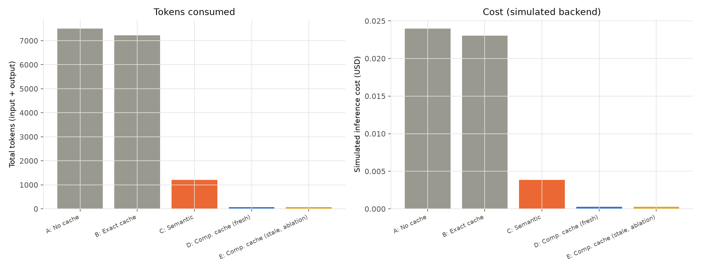
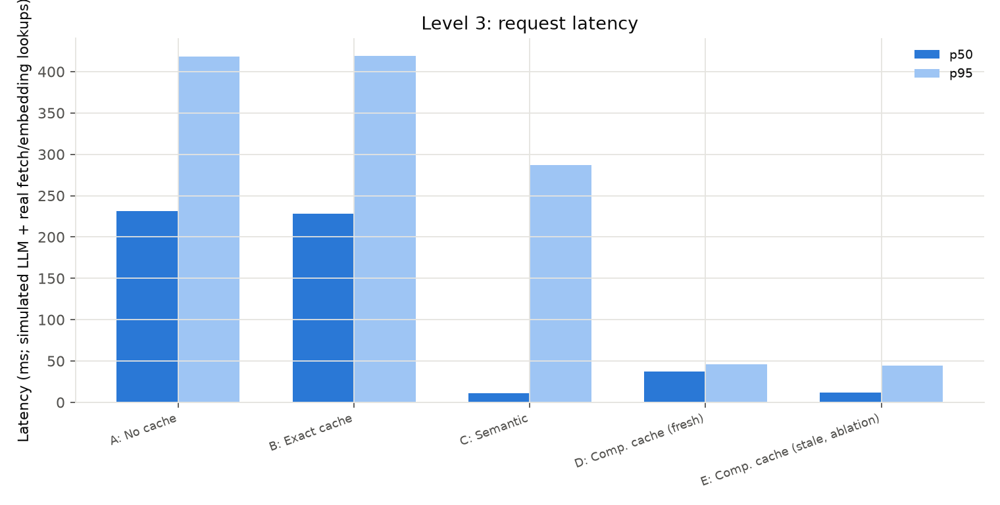
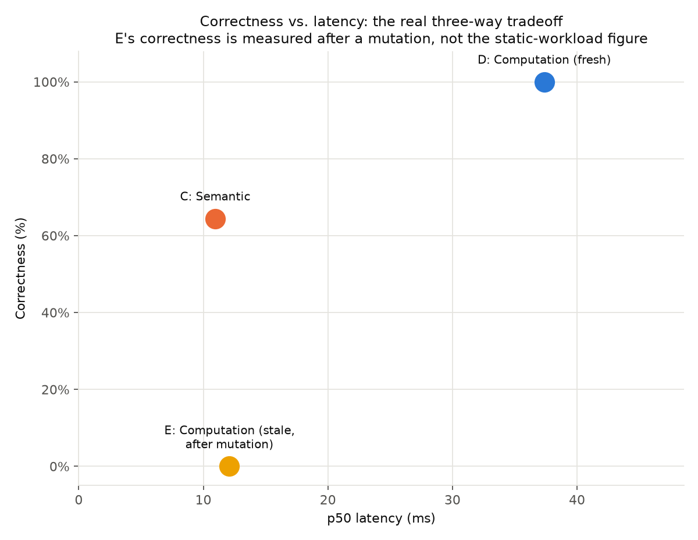

# Level 3: Database-Backed Enterprise Workflows

> **Update 2026-10-20.** Most results in this file were measured at a single seed.
> A later multi-seed rerun changed some of them. The computation cache is not
> literally 0% invalid: it made 20 wrong hits in 1500 Level 1/2 requests over 10
> seeds (fixed by a guard, EXP-016) and 1 wrong hit in 2250 Level 3 requests
> (EXP-017). Read "0% invalid" or "100% correct" below as "zero at the seed
> measured". Comparisons against a raw, unscaffolded LLM used a weak baseline;
> EXP-015 has the fair one. Details: [experiment-log.md](experiment-log.md),
> EXP-015 to EXP-017.

## Motivation and scope

`docs/architecture.md` scoped the original prototype to Levels 1/2
(closed-form arithmetic and business formulas) and explicitly deferred
Level 3 as future work, on the grounds that it needs "a different
computation representation... and introduce[s] failure modes (stale
data...) this prototype's validation layer doesn't model." This
document covers the phase that actually built that: workflow tasks that
read live, mutable enterprise state (customers, transactions, tier
policies) before producing an answer.

The central design correction driving everything in this document,
made explicit before any code was written: **a database generated once
and never touched again cannot test freshness.** Level 1/2's workload
is static by design — arithmetic doesn't have a "current state" to go
stale. Level 3's workload family only exists to test the opposite
claim, so the database backing it has to actually *change* mid-run, on
purpose, in a controlled way (`aicache/enterprise/db.py`'s mutation
methods) — not be regenerated once and left alone.

**This document does not implement or claim results for Level 4**
(parameterized workflow *graphs*, branching execution, tool-result and
intermediate-artifact caching). That scope boundary was explicit from
the start of this phase — see "Deferred: Level 4" at the end of this
document for what it would require and why it wasn't attempted here.

## The core architectural principle: cache the plan, not the data

Level 1/2's computation cache reused a *procedure* (which arithmetic
operation to run) and rebound *parameters* fresh on every hit — never a
stored answer. Level 3 generalizes that same principle one level up:
what's reusable across two structurally-identical enterprise requests
("Is customer X eligible for a refund on transaction Y?" for two
different (X, Y) pairs) is the *plan* — which entities to extract,
which tables to fetch, which formula to apply to the fetched values —
never the fetched values themselves, and never the final answer.

Concretely: every `WorkflowTaskSpec` in
`aicache/computation/workflow_tasks.py` declares
`freshness_requirements="always_fresh"`, unconditionally. At Level 1/2
this field existed but was decorative — every task was `"static"` and
nothing ever branched on it. At Level 3 it's load-bearing: the fetch
step in `aicache/cache/workflow_computation.py`'s pipeline re-reads live
state from `EnterpriseDB` on **every single lookup, hit or not** — a
cache hit here means "we reused the plan," never "we reused the data
the plan produced last time."

## System design

### The enterprise database (`aicache/enterprise/db.py`)

An in-memory, mutable store — `customers`, `transactions`, `policies`
dicts, deliberately not a real SQL engine (nothing about the research
question needs one, and this project has stayed dependency-light
throughout). `generate_enterprise_db(seed, n_customers, n_transactions)`
builds a synthetic but internally consistent dataset: `CUST-0000`-style
customer IDs with a tier (`bronze`/`silver`/`gold`, weighted
`[0.5, 0.35, 0.15]`), region, and account status; `TXN-000000`-style
transactions each owned by a real customer, with an amount, a status
(`completed`/`pending`/`refunded`/`disputed`), and an age (`day`) drawn
from a recency-skewed exponential distribution rather than uniform —
see "Bugs found and fixed" below for why that distribution choice
matters and isn't cosmetic.

Every fetch method (`fetch_customer`, `fetch_transaction`,
`fetch_policy`, `fetch_transactions_for_customer`,
`fetch_shipping_rate`) simulates an 8ms round-trip
(`time.sleep`) and returns a **copy** of the underlying row, never a
live reference — see "Bugs found and fixed" for why the copy is
load-bearing, not defensive boilerplate. Mutation methods
(`mutate_customer_tier`, `mutate_transaction_status`,
`mutate_transaction_amount`, `mutate_policy`) change the underlying
store in place and append a human-readable entry to an internal
mutation log. `clone()` deep-copies the whole database so multiple
baselines in one experiment run can replay the identical starting state
independently, without fighting over one shared mutable object.

### The computation representation (`aicache/computation/workflow_tasks.py`)

`WorkflowTaskSpec` is a deliberately separate dataclass from Level 1/2's
`TaskSpec`, not a subclass or a shared base — the shapes are genuinely
different (numeric positional params vs. named, typed entities + a
live-data fetch + a structured multi-field output), and the phase brief
was explicit: *extend*, don't redesign, the Level 1/2 experiment. Each
spec bundles:

- `entity_slots`: named, regex-matched identifiers (`customer_id`,
  `transaction_id`, `zone`)
- `number_slots`: plain numeric parameters, when the task has any
  (`order_total`, `weight`)
- `fetch(entities, numbers, db) -> FetchOutcome`: the whole "which rows
  does this task need" plan as one function — a deliberate scope limit
  (see "Deferred: Level 4"); conditional or data-dependent fetch plans
  are out of scope here
- `executor(**entities, **numbers, **fetched) -> dict`: a pure function
  from bound parameters + fetched data to a structured result
- `output_fields`, `freshness_requirements` (always `"always_fresh"`),
  `example_phrasings` (used for embedding-based identification, same
  mechanism as Level 1/2)

Five task families are registered in `WORKFLOW_TASK_REGISTRY`:

| Task | Entities | Numbers | Fetches | Computes |
|---|---|---|---|---|
| `refund_eligibility` | customer_id, transaction_id | — | customer, transaction, policy | eligible (status + refund-window check), refund_amount, reason |
| `loyalty_discount` | customer_id | order_total | customer, policy | discount_percent, discount_amount, final_amount |
| `shipping_cost` | customer_id, zone | weight | customer, policy, zone rate | cost, free_shipping |
| `customer_spend_summary` | customer_id | — | customer, all their transactions | transaction_count, total_spend, average_spend |
| `transaction_risk` | customer_id, transaction_id | — | customer, transaction | risk category (low/medium/high) |

### Entity extraction (`aicache/binding/entity_extractor.py`)

A deliberate improvement over Level 1/2's parameter binding, not a
like-for-like port. Level 1/2's `extract_numbers` pulls plain numbers
left-to-right and zips them positionally against a task's declared
parameter order — a real, documented fragility (two template-ordering
bugs exploited exactly this; see `docs/experiment-log.md` EXP-002/003).
Enterprise identifiers are typed and prefixed (`CUST-0042`,
`TXN-000123`, `zone-2`), so each entity slot is matched by its **own**
regex, independent of where it sits in the sentence — "Assess the risk
of transaction TXN-000123 for customer CUST-0042" (transaction
mentioned first) extracts correctly even though `transaction_risk`
declares `customer_id` before `transaction_id`. Matched entity
substrings are stripped from the text before the remaining plain-number
slots (`order_total`, `weight`) are extracted, so an ID's own digits
(the `0042` in `CUST-0042`) never leak into a numeric parameter.

### The pipeline and latency decomposition (`aicache/cache/workflow_computation.py`)

Five named stages, each independently timed into a `LatencyBreakdown`
(`identify_ms`, `extract_ms`, `validate_ms`, `fetch_ms`, `execute_ms`) —
not just an aggregate number, so it's possible to see *where* a
request's time actually goes rather than only how much of it there was:

1. **Identify** — embed the request, nearest-neighbor match against
   `WORKFLOW_TASK_REGISTRY`'s example phrasings. Same `TaskIdentifier`
   class Level 1/2 uses, generalized to accept either registry via a
   constructor parameter rather than forked — the one piece of matching
   machinery genuinely shared between the two phases.
2. **Extract** — entities + numbers, as above.
3. **Validate** — a hard gate before execution: every extracted numeric
   value must be finite and every declared entity/number slot must have
   been found. Missing slots (identification succeeded but binding
   didn't) or non-finite numbers both force a fallback rather than
   executing on an incomplete or unsafe binding — same "validation as
   hard gate" principle as Level 1/2 (`docs/architecture.md`), reused
   unchanged in spirit.
4. **Fetch** — read current state from `EnterpriseDB`. **Always** re-run
   for the primary condition (D); optionally memoized for the ablation
   (E) — see next section.
5. **Execute** — a pure function from bound parameters + fetched values
   to a structured result. No LLM call anywhere in a hit path, at any
   stage.

### Baselines A-E

Structurally different from Level 1/2's baselines in one respect: every
condition here needs the fetch step, not just the computation cache.
A/B/C's "ask an LLM on a miss" always runs through a fetch first — the
model cannot answer a question about a specific customer/transaction
without the current data any more than the computation cache can,
mirroring what a real RAG/tool-using agent has to do before it can
reason. This is a prerequisite for producing *any* plausible answer, not
a caching optimization for A/B/C specifically. What actually differs
between conditions is what gets *reused*:

- **A — No cache**: fetch fresh, ask the LLM, every time.
- **B — Exact cache**: byte-identical request text only.
- **C — Semantic cache**: nearest-neighbor request similarity, reuses a
  full stored **answer** — the failure mode this whole investigation
  exists to characterize, now at higher stakes (see Results).
- **D — Computation cache (primary)**: reuse the plan; entities and
  data are rebound and re-fetched fresh on every single lookup.
- **E — Stale-fetch ablation, *not a fifth primary condition***: the
  identical class as D, with one flag flipped
  (`use_stale_cache=True`) — the first fetch for a given
  (task_type, entity-values) combination is memoized and reused on
  every later lookup, even across a database mutation. E exists
  specifically to demonstrate *why* D always re-fetches, by showing
  what goes wrong when it doesn't. Per the phase brief: **E is scored
  and reported everywhere, but never described as beating or competing
  with A-D** — it's an ablation, not a fifth strategy under evaluation.

D and E share one class (`WorkflowComputationCache`) with one
constructor flag, deliberately — the point of the ablation only holds
if the two conditions are identical in every other respect.

## Freshness model and the state-mutation experiment

Every task's `freshness_requirements` is `"always_fresh"` — Level 3 has
exactly one freshness class, not several with different rules, since
every one of the five task families reads state (account status,
transaction status, tier, policy) that can legitimately change between
one request and the next.

The primary comparison workload (below) intentionally does **not**
mutate the database mid-run — see `workloads/level3/generator.py`'s own
module docstring. Testing freshness needs a different, sequential,
stateful experiment shape than a shuffled, parallel comparison run, so
it's a separate deliverable:
`benchmarks/level3/freshness_experiment.py` runs three independent,
hand-picked, fully-inspectable scenarios — small by design (an
averaged statistic isn't the point; a reader being able to check every
step by eye is):

1. **Transaction status mutation** — a completed, refund-eligible
   transaction is marked `refunded`.
2. **Customer tier mutation** — a customer is upgraded `bronze` →
   `gold`, changing their loyalty discount percentage.
3. **Policy mutation** — the `gold` tier's refund window is shortened
   `60` → `30` days, moving a specific transaction from inside to
   outside the window.

Each scenario: issue a request, record what `semantic_cache`, D, and E
answer; mutate the database; issue the *identical* request again;
record what each answers now; compare against ground truth computed
independently (via the task's own `fetch`+`executor`, called directly,
never read back from any baseline) at both points in time.

## Workload generation and ground truth (`workloads/level3/`)

The primary comparison workload follows the same structural-repetition
principle as Level 1/2 (`workloads/generators.py`), extended from bare
numbers to named entities: for each of the 5 task families, several
distinct entity combinations, each rendered through several paraphrase
templates. `_pick_customer_and_transaction` deliberately picks a
transaction *first* and uses its real owner as the customer, guaranteeing
every generated combination is valid (the transaction really does
belong to that customer) rather than risking an uninteresting automatic
fallback from an independently-mismatched pair.

Ground truth (`expected_result`) is computed once, at generation time,
by calling the task's own `fetch` + `executor` directly — independent
of any baseline's own cache instance, exactly the oracle discipline the
phase brief required. This is valid precisely because the database is
static for the duration of this workload's use (see previous section);
the freshness experiment recomputes ground truth at each step instead,
since its whole point is a database that changes mid-run.

## Results

Reported as **two separate experiments with two separate correctness
numbers, deliberately not merged into one table.** They answer different
questions and are not comparable request-for-request: Experiment A
measures behavior under this workload's normal (zero mid-run mutation)
traffic; Experiment B measures behavior at the moment a mutation
actually happens. A baseline's correctness is a function of how much
mutation exposure it faced during measurement — not a single fixed
property of the baseline — and reporting only one of the two numbers
would misrepresent what was actually measured. This split (and the
warning below) exists because an earlier draft of this document
presented Experiment A's aggregate table as if it were the whole
picture, which let the stale-fetch ablation's 100% correctness stand
unqualified next to the fresh condition's — technically accurate for
what Experiment A measures, but dangerously easy to misread as "the
stale ablation is safe."

### Experiment A — general Level 3 workload (no mutation)

`python -m benchmarks.level3.run_experiment` (defaults: seed=99,
db_seed=42, 80 customers, 200 transactions, 15 entity combinations × 3
paraphrases per task type → 225 requests across the 5 task families, all
run against independent `db.clone()` snapshots so every baseline sees
identical starting state, and **the database is never mutated during
this run**):

| Baseline | Hit% | Valid% | Invalid% | Fallback% | Correct% | Tokens | Cost (USD) | p50 (ms) |
|---|---|---|---|---|---|---|---|---|
| A — No cache | 0.0% | 0.0% | 0.0% | 0.0% | 100.0% | 7,504 | 0.02398 | 231.5 |
| B — Exact cache | 3.6% | 3.6% | 0.0% | 0.0% | 100.0% | 7,220 | 0.02302 | 228.1 |
| C — Semantic cache (0.65) | 84.0% | 48.4% | 35.6% | 0.0% | 64.4% | 1,210 | 0.00387 | 11.0 |
| D — Computation cache (fresh) | 99.1% | 99.1% | 0.0% | 0.9% | 100.0% | 77 | 0.00025 | 37.4 |
| E — Stale-fetch ablation | 99.1% | 99.1% | 0.0% | 0.9% | 100.0% | 77 | 0.00025 | 12.1 |

> **⚠️ Do not cite E's 100% correctness from this table on its own.**
> It is real, and it is not a bug — but it holds *only* because this
> workload has 0% mutation exposure between a request and any later
> reuse of its answer. It is not evidence that the stale-fetch ablation
> is a safe strategy; Experiment B below measures the same baseline
> under mutation and finds the opposite (0/3 correct). Whenever E's
> number from this table is quoted, it must be quoted alongside
> Experiment B's — see the combined view at the end of this section.

**Why D and E score identically here, and why that's expected, not a
wasted ablation**: without a mutation, "always re-fetch" and "fetch
once, reuse forever" return the same value — nothing in the underlying
data changed between the two reads. The *correctness* gap between them
only appears once the database changes mid-experiment, which this run
deliberately doesn't do (that's what Experiment B is for). What this run
*does* show, even without any mutation, is a latency difference: D's
mean fetch time on a hit is 23.17ms, E's is 7.33ms — because roughly
two-thirds of E's hits reuse a memoized fetch from an earlier paraphrase
of the same entity combination (0ms fetch), while D re-fetches every
single time by design. That gap alone — real work skipped, zero
correctness cost, *in a workload with no mutations* — is exactly the
temptation memoization exists to offer, and exactly why Experiment B
matters: the same mechanism that buys E its speed is what breaks it the
moment the underlying data actually changes.

**The computation cache's two fallbacks are a genuine, useful
near-miss, not a clean pass.** Both are `loyalty_discount` requests
("Calculate the loyalty discount for CUST-0027 on an order total of
$389.43." and its paraphrase) that `TaskIdentifier` scored as closer to
`refund_eligibility` (similarity 0.57 and 0.59) than to
`loyalty_discount` — a real misidentification, not a hypothetical one.
Both were caught downstream: `refund_eligibility` requires a
`transaction_id` entity slot this text doesn't contain, so extraction
reported a missing slot and the request safely fell back to the LLM
rather than executing against the wrong plan. This is the validation
gate doing exactly the job it exists to do — the two events that would
have been Level 3's first invalid computation-cache hits, if extraction
hadn't been there to catch them.

**Semantic caching's failure mode is sharper here than at Level 1/2.**
`docs/hypotheses.md` (H2) found a well-tuned semantic cache with a
strong embedding model could reach 0.7% invalid-hits on Level 1/2's
arithmetic workload. Here, at a comparable threshold (0.65), it's
35.6% — because the two things that actually determine a Level 3
answer (*which* customer, *which* transaction) are exactly the parts of
the request text that carry the least semantic weight to an embedding
model. "Is customer CUST-0042 eligible for a refund on transaction
TXN-000123?" and "Is customer CUST-0091 eligible for a refund on
transaction TXN-000456?" are nearly identical in embedding space and
describe completely different people's money. Level 1/2 could only ever
demonstrate this failure mode with plain numbers; Level 3 demonstrates
it with identity.

### Experiment B — controlled freshness mutation

`python -m benchmarks.level3.freshness_experiment`
(`results/level3/freshness_experiment.json` has the full machine-readable
record, including the aggregate `summary` block below):

| Scenario | Mutation | semantic_cache after | D (fresh) after | E (stale ablation) after |
|---|---|---|---|---|
| `refund_eligibility_after_status_change` | transaction `completed` → `refunded` | "Yes... $500.00" — **wrong** | "No... (transaction_not_completed)" — correct | "Yes... $500.00" — **wrong** |
| `loyalty_discount_after_tier_upgrade` | customer tier `bronze` → `gold` | "0% discount... $400.00" — **wrong** | "10% discount... $360.00" — correct | "0% discount... $400.00" — **wrong** |
| `refund_eligibility_after_policy_change` | gold refund window `60` → `30` days | "Yes... $300.00" — **wrong** | "No... (outside_refund_window)" — correct | "Yes... $300.00" — **wrong** |

All three ground truths genuinely changed after their mutation
(verified independently at each step, not read back from any
baseline). In all three: **D is the only condition that reflects the
mutation.** `semantic_cache` and E both keep serving the exact
pre-mutation answer, silently, with no signal to the caller that
anything is wrong — E because its fetch is memoized by construction (the
ablation doing precisely what it's designed to demonstrate), and
`semantic_cache` because the request text is byte-identical to what it
already has an answer cached for, so it hits without ever re-examining
whether the world changed underneath that answer.

**Aggregate, over the 3 scenarios (100% mutation exposure, by
construction — every scenario mutates the record between the "before"
and "after" request):**

| Baseline | Post-mutation correctness |
|---|---|
| D — Computation cache (fresh) | 3/3 (100%) |
| E — Stale-fetch ablation | 0/3 (0%) |
| C — Semantic cache | 0/3 (0%) |

This is the concrete demonstration of "cache the plan, not the data":
D's plan (which entities, which fetches, which formula) is exactly as
reusable after each mutation as before it — what changes is the *data*
the plan reads, and D never caches that.

### The combined, honest three-way view

Neither experiment alone gives a fair correctness number for every
condition: Experiment A is fair for D (correct regardless of mutation
exposure — confirmed directly by Experiment B's 3/3) and fair for C
(its failure mode is embedding proximity, not staleness, so it doesn't
depend on mutation exposure the way E does) — but Experiment A's number
for E is only fair *as a statement about zero-mutation traffic specifically*.
The chart below combines them correctly: C and D take their correctness
from Experiment A, E takes its correctness from Experiment B, and all
three take their latency from Experiment A (latency is a property of
the mechanism — memoized vs. always-fetch — not of whether a mutation
happened to occur, so it's fair to report from either experiment; the
larger sample in Experiment A is the better source).

| Condition | Correctness | Latency (p50) | Correctness source |
|---|---|---|---|
| C — Semantic cache | 64.4% | 11.0ms | Experiment A (general) |
| D — Computation cache (fresh) | 100% | 37.4ms | Experiment A (general) — confirmed by Experiment B (3/3) |
| E — Computation cache (stale ablation) | **0%** | 12.1ms | Experiment B (post-mutation) — **not** Experiment A's 100% |

Read this way, E is not "as good as D but faster" — it is "as fast as a
lookup, with correctness that degrades to 0% at the mutation rate this
experiment tested." Its true correctness for any real deployment
depends entirely on how often the underlying data changes relative to
how often it's queried, which Experiment B doesn't estimate (three
scenarios, each with a mutation on every trial, not a realistic mutation
*rate*) — see "Next: structural locality and state volatility" below for
the follow-up this motivates.

## Bugs found and fixed during this phase

Kept here rather than silently corrected, per this project's standing
documentation practice (`docs/experiment-log.md`).

1. **Live-reference staleness bug (`aicache/enterprise/db.py`).** Every
   `fetch_*` method originally returned the actual stored dict, not a
   copy. This meant E's memoized fetch and the live table row were the
   *same object* — mutating the table in place silently mutated E's
   "stale" data too, making the freshness ablation not actually stale.
   This would have completely defeated the point of the experiment the
   ablation exists to run. Caught by a targeted smoke test (construct an
   eligible-refund scenario, mutate the transaction, observe E
   incorrectly "flip" to match D) before any real experiment used the
   fix. Fixed by having every fetch method return `dict(row)`.

2. **Workload realism / class-imbalance bug
   (`aicache/enterprise/db.py::generate_enterprise_db`).** Transaction
   age (`day`) was originally drawn uniformly over the full 1000-day
   history. Checked against the *entire* generated database (not a
   workload sample) before trusting the generator, this put only 2.5-5%
   of all transactions within any tier's refund window (14-60 days) —
   a structural skew, not sampling bad luck. Fixed by switching to a
   recency-skewed exponential distribution
   (`max(1, 1000 - round(rng.expovariate(1/150)))`), which is also more
   realistic for a live transaction log (recent activity dominates) and
   raised in-window eligibility to 9-12%.

3. **Renderer/parser ordering bug (`aicache/llm/workflow_rendering.py`).**
   `customer_spend_summary`'s natural-language rendering originally put
   the supporting field (`average_spend`) after the headline field
   (`total_spend`); the matching correctness checker
   (`aicache/metrics/workflow_correctness.py`) takes the *last* dollar
   figure in the text, so it silently picked up the wrong number. Caught
   by direct round-trip testing (render → parse → compare) before this
   ever reached an experiment run. Fixed by reordering the sentence so
   the headline figure is always last — the same convention every other
   Level 3 renderer already followed.

4. **`freshness_experiment.py`'s own LLM task-hint bug**, found while
   validating this document's results. The script built the simulated
   LLM's `task_hint["params"]` from the ground-truth *result* dict
   (e.g. `{"eligible": ..., "refund_amount": ...}`) instead of the raw
   *fetched* data the executor actually takes as keyword arguments
   (e.g. `{"transaction": {...}, "policy": {...}}`), so every
   `semantic_cache` call in the first run of this experiment errored
   with `_execute_refund_eligibility() got an unexpected keyword
   argument 'eligible'`. Fixed by fetching and executing separately and
   passing the raw fetched fields into the task hint, not the already-computed
   result. A bug in this document's own measurement tooling, not in any
   module under test — flagged rather than quietly corrected before
   anyone noticed the first run's `semantic_cache` answers were garbage
   text.

5. **A reporting-clarity issue, not a code bug, caught in review of an
   earlier draft of this document**: that draft presented Experiment A's
   aggregate table (stale-fetch ablation E at 100% correctness, matching
   D) as the headline Level 3 result, with Experiment B's contradicting
   finding (E at 0% correctness post-mutation) written up separately and
   further down. The two numbers are both correct for what they each
   measure — but presenting Experiment A's in isolation, without its
   0%-mutation-exposure qualifier attached, invites exactly the wrong
   conclusion ("the stale ablation is safe"). Fixed by restructuring
   Results into explicit Experiment A / Experiment B sections, adding an
   unmissable warning directly under Experiment A's table, and adding a
   combined view (`correctness_latency_tradeoff.png`) that sources E's
   correctness from Experiment B rather than Experiment A. See "The
   combined, honest three-way view" above.

6. **A chart-completeness issue, caught in the same review**: the
   original `hit_rate_by_baseline.png` only stacked `valid_hit_rate` and
   `invalid_hit_rate`, silently omitting whatever fraction of a
   baseline's traffic went to the LLM (a `miss` for A/B/C, a `fallback`
   for D/E). For D and E this made a real, meaningful 0.9% fallback rate
   (the two genuine misidentifications the validation gate caught —
   see Experiment A above) invisible, since the bar topped out at 99.1%
   and read as a flat 100% at a glance. Fixed by stacking a third
   "went to the LLM" segment on every bar (so each one sums to exactly
   100%) and adding a direct leader-line callout on D/E's slice
   specifically, since 0.9% is real but too thin to read at its true
   proportion otherwise.

## Hypotheses (Level 3)

Evaluated against the primary comparison run (EXP-009) and the
freshness experiment (EXP-010) in `docs/experiment-log.md`.

### L1 — The "cache the plan, not the data" principle generalizes beyond arithmetic to live, multi-table enterprise workflows.

**Supported.** Five task families spanning eligibility rules,
percentage-based formulas over live policy, and multi-row aggregation
all reached 100% correctness on every hit (223/223), with zero invalid
hits, by re-fetching and re-executing rather than reusing any prior
answer.

### L2 — A database that never changes cannot demonstrate a freshness benefit; a mutating one can, and does so cleanly.

**Supported, with a reporting caveat that had to be corrected in this
document.** Experiment A alone (static database) shows D and E as
statistically identical — informative on its own only about latency,
not correctness, and **not sufficient grounds to call E's correctness
100% in general**, even though that's what its own table reports.
Experiment B shows the gap Experiment A structurally cannot: at 100%
mutation exposure (every scenario's underlying record changes between
the two requests), D is 3/3 (100%) and E is 0/3 (0%) — the same
baseline name, two very different numbers, because correctness here is
a function of mutation exposure, not a fixed property of the baseline.
See "The combined, honest three-way view" in the Results section.

### L3 — At higher-stakes, identity-bearing workloads, semantic response caching's false-hit rate gets worse, not better, than at Level 1/2.

**Supported.** 35.6% invalid-hit rate here vs. 0.7% for the tuned
Level 1/2 configuration in `docs/hypotheses.md` H2, using a comparable
embedding model. The mechanism: identifiers carry the decision-relevant
information but almost none of the semantic weight an embedding model
responds to.

### L4 — Validation-as-hard-gate catches real misidentification events, not just hypothetical ones.

**Supported.** Two genuine `loyalty_discount` → `refund_eligibility`
misidentifications occurred in the primary run (similarity 0.57 and
0.59, above the 0.45 identification threshold) and were both caught by
missing-slot validation before execution, forcing a safe fallback
instead of a wrong answer.

### L5 — Decomposed latency instrumentation reveals costs an aggregate number hides.

**Supported.** The five-component breakdown shows fetch time (23.17ms
mean for D) dominates identify time (15.98ms) on a hit — the opposite
of what Level 1/2's identification-heavy pipeline would suggest, and
visible only because latency was tracked per-stage rather than as one
number.

## Research questions

**RQ1 — Does computation-structure reuse extend past pure arithmetic to
workflows that must read live external state?** Yes — see L1. The
mechanism (identify → extract → validate → fetch fresh → execute) is
unchanged in shape from Level 1/2; only the fetch step and the entity
extraction are new.

**RQ2 — Is the "always re-fetch" design choice actually load-bearing, or
would memoization have been just as correct?** Load-bearing — see L2 and
the freshness experiment. Memoization (E) is strictly faster when
nothing changes and silently wrong the moment something does, with no
signal distinguishing the two cases to a caller.

**RQ3 — How much does entity/identity information degrade semantic
response caching specifically (as opposed to computation caching)?**
Substantially — see L3. 35.6% invalid-hit rate vs. 0% for the
computation cache on the identical workload, same embedding model
family used successfully at Level 1/2.

**RQ4 — Does the validation gate that Level 1/2 justified in principle
actually fire on real, unforced misidentification events at Level 3?**
Yes — see L4. Not a synthetic worst-case test; two genuine
misidentifications occurred unprompted in a 225-request run and were
both safely caught.

**RQ5 — What does per-stage latency decomposition show that an
aggregate hit-latency number would hide?** That fetch, not
identification, dominates a Level 3 hit's cost (23.17ms vs. 15.98ms
mean) — see L5 and `results/level3/latency_breakdown_d_vs_e.png`. At
Level 1/2, with no fetch step at all, identification was effectively
the *entire* hit cost; that balance flips once real I/O enters the
pipeline.

**RQ6 — Does computation caching still reduce LLM token/cost load at
Level 3, given fallbacks now also carry a mandatory fetch?** Yes,
sharply — 77 tokens / $0.00025 total vs. 7,504 tokens / $0.02398 for
no-cache (a 99.0% token reduction), because only 2 of 225 requests
(0.9%) ever reached the LLM at all.

**RQ7 — Does hit rate alone remain an unreliable proxy for
correctness, as it was at Level 1/2 (H7)?** Yes, more dramatically.
`semantic_cache`'s 84.0% hit rate is the *second-highest* of any
condition, while its 64.4% correctness is the *worst* — reading hit
rate alone would rank it ahead of exact caching; reading it with the
valid/invalid split reverses that.

**RQ8 — Does the stale-fetch ablation (E) ever look like a viable
primary strategy on its own numbers, absent the freshness experiment?**
On the primary run's numbers alone — yes, deceptively so: identical hit
rate and correctness to D, but faster (p50 12.1ms vs. 37.4ms). This is
exactly why E is scored as an ablation and never presented as a
competing baseline (see "Baselines A-E" above) — its numbers in
isolation actively invite the wrong conclusion, and only the mutation
experiment reveals why.

**RQ9 — Where is the boundary of what this phase's results can claim?**
Narrowly: five hand-specified, deterministic-once-fetched task
families, a single synthetic database, one embedding model, a single
un-repeated run per experiment (same limitation as every prior phase —
see `docs/evaluation.md`). This does **not** demonstrate that
computation caching works for arbitrary agents, open-ended tool use, or
tasks whose fetch plan itself depends on intermediate results —
that boundary is Level 4's, deliberately not crossed here (see below).

**RQ10 — What would have to change for this approach to reach Level 4
(agentic, branching workflows)?** See "Deferred: Level 4" — a
different, DAG-shaped computation representation, conditional fetch
plans, and at least one new cache-object type (tool-call results,
intermediate artifacts) that this phase's flat
`entities → fetch → executor` shape doesn't support.

## Limitations

- **Single run per experiment, one seed, one embedding threshold** —
  same caveat `docs/evaluation.md` states for every prior phase.
  Specific percentages here are illustrative of the pattern, not a
  statistically validated estimate.
- **Simulated LLM backend only** — no real-model validation attempted
  for Level 3 in this phase (EXP-007/008's Gemini/Ollama validation was
  Level 1/2-only). The correctness checker
  (`aicache/metrics/workflow_correctness.py`) has been round-trip tested
  against this repo's own renderer, not against real model phrasing
  variance.
- **Five hand-specified task families** — not a claim that arbitrary
  enterprise workflows fit this shape; a claim that these five,
  representative of common eligibility/discount/aggregation/risk
  patterns, do.
- **The freshness experiment is three hand-picked scenarios, not a
  statistical sample** — deliberately so (see "Freshness model" above);
  it demonstrates the mechanism clearly, it does not estimate how often
  staleness would matter in a real deployment's request mix.
- **The identification threshold (0.45) is calibrated on this specific
  workload's 5 task types**, which embed further apart from each other
  than Level 1/2's 9 arithmetic operations did — not a claim that 0.45
  is a universal constant.

## Next: structural locality and state volatility — done in Level 3b

Level 3 showed the architecture works when the computation is a
parameterized, deterministic workflow over freshly-fetched state (RQ9's
boundary), but this phase's own workload held two variables fixed:
structural locality (a small, repeated set of entity combinations) and
state volatility (measured at only two points, 0% and 100% mutation
exposure). Both are now swept directly, with measured response curves
rather than a qualitative flag — see **`docs/level3b.md`**.

Headline results, in brief (full discussion in `docs/level3b.md`):
computation-cache hit rate and correctness stay flat across a 40x range
of entity-combination diversity, while semantic caching's correctness
falls *and its hit rate rises* over the same range (a sharper, more
counterintuitive version of H7 — more distinct entities means more
near-duplicate false neighbors, not fewer real matches); and
correctness under mutation exposure follows `1 − mutation_rate`
precisely for both semantic caching and the stale-fetch ablation, while
the always-fresh condition stays flat at 100% regardless of rate.

## Deferred: Level 4

Sketched during this phase's design discussion but explicitly not
implemented: parameterized workflow *graphs* (branching execution,
conditional fetch plans where what to fetch next depends on what was
just fetched) and at least four distinct cache-object types (the plan
itself; fetched data, never cached across requests, per this phase's
whole thesis; tool-call results, cacheable under their own freshness
rules; intermediate artifacts partway through a multi-step plan).
Level 3's `WorkflowTaskSpec.fetch` is intentionally a single function
encapsulating one flat fetch plan — real branching (Level 4) needs a
composable, inspectable plan representation this phase's flat shape
doesn't provide, plus a validation story for *partial* plan reuse (is it
still safe to reuse steps 1-3 of a 5-step plan if step 4's data
changed?) that this phase's all-or-nothing validation gate doesn't
answer. Attempting it without a stable Level 3 result to build on would
have risked confusing bugs in the harness with genuine findings about
Level 4 itself — exactly the discipline this project applied when it
deferred Level 3 out of the original Level 1/2 prototype.
