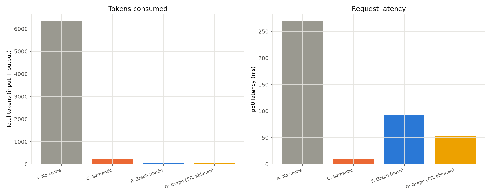

# Level 4: Branching Workflows and Graduated Freshness

> **Update 2026-10-20.** Most results in this file were measured at a single seed.
> A later multi-seed rerun changed some of them. The computation cache is not
> literally 0% invalid: it made 20 wrong hits in 1500 Level 1/2 requests over 10
> seeds (fixed by a guard, EXP-016) and 1 wrong hit in 2250 Level 3 requests
> (EXP-017). Read "0% invalid" or "100% correct" below as "zero at the seed
> measured". Comparisons against a raw, unscaffolded LLM used a weak baseline;
> EXP-015 has the fair one. Details: [experiment-log.md](experiment-log.md),
> EXP-015 to EXP-017.

## Motivation and scope

`docs/level3.md` deferred Level 4 explicitly: "parameterized workflow
*graphs* (branching execution, conditional fetch plans...) and at least
four distinct cache-object types." `docs/level3b.md` then swept the two
variables Level 3's primary comparison held fixed (structural locality,
state volatility) before this phase started, on the explicit reasoning
that a stable Level 3 result should exist before building on top of it.
Both are done; this phase builds the one thing Level 3's flat pipeline
structurally could not test.

**What Level 4 actually needed to prove, grounded in research, not
invention.** Before writing any code, this phase researched how real
production agent frameworks and the closest academic work handle
exactly this problem (`docs/differentiation.md`, `docs/prior-art.md`).
Two findings shaped this phase's design directly:

1. **LangGraph's `CachePolicy(ttl=...)`** — the most popular agent
   framework's real node-caching feature — memoizes a node's output by
   hashing its input, with an optional TTL, and is architecturally
   identical to this repo's Level 3 ablation (E). Verified with a live,
   reproducible demo against the actual library
   (`docs/differentiation.md` §3). Level 3's own freshness model was
   binary (always-fresh or memoized-forever) and never actually tested
   a *bounded* TTL, the specific mechanism a real system uses.
2. **No source found — real framework, real production case study, or
   academic paper — quantifies how a TTL cache's correctness degrades
   as a function of both TTL length and how fast the underlying data
   actually changes.** That gap is what this phase's TTL sweep fills.

**This phase implements one hand-specified branching task, not a
general graph engine** — the same narrow-scope discipline Level 3
applied (5 hand-specified task families, not an open-ended registry).
One task is enough to exercise branching and graduated freshness; a
general DAG interpreter would be new complexity with no new evidence to
show for it.

## The task: `return_decision`

Extends the existing `EnterpriseDB` (no new domain) with one new
concept — a fraud score, batch-computed and legitimately safe to reuse
for a bounded window in a real system, unlike Level 3's fetches (which
must always be fresh). The workflow:

```
check refund_eligibility (identical rule to Level 3's task of that name)
  -> not eligible: DENY                                    [branch: not_eligible]
  -> eligible, refund <= $500: APPROVE, no fraud check      [branch: auto_approve_low_value]
  -> eligible, refund > $500:
       check fraud_score
         -> score >= 0.7 (high risk): DENY                 [branch: fraud_flagged]
         -> else: APPROVE                                  [branch: fraud_cleared]
```

Four branches, a genuine conditional second fetch (fraud score is only
ever looked up for eligible, high-value returns), and reuse of Level
3's exact eligibility rule as a sub-step — proving composability, not
just branching in isolation.

### Why this reuses Level 3's entire pipeline unchanged

The temptation with "branching" is to assume a new pipeline is needed.
It isn't. `WorkflowTaskSpec.fetch` was already just a function from
`(entities, numbers, db)` to a values dict — nothing about its contract
requires that function to be a straight line. `return_decision`'s
`fetch` (`aicache/computation/graph_tasks.py::_fetch_return_decision`)
internally branches: it always fetches customer/transaction/policy,
computes eligibility, and *conditionally* fetches a fraud score only
when the branch requires it. `TaskIdentifier`,
`WorkflowComputationCache`, `entity_extractor.py` — none of them
changed to make this work.

### Graduated freshness: the one thing that did need a new primitive

Level 3's `WorkflowComputationCache` had exactly one freshness knob
(`use_stale_cache`), applied to an entire task's fetch. Level 4 needs
two different freshness rules *within one task's fetch*: customer/
transaction/policy must always be fresh (Level 3 already proved caching
those is never safe); the fraud score is a legitimate TTL-cache
candidate. `aicache/cache/ttl_cache.py::TTLCache` — modeled directly on
LangGraph's real `CachePolicy` mechanism, not invented — is injected
into the `fetch` closure at spec-construction time
(`build_return_decision_spec(fraud_cache)`), so two different task
registrations under the same `task_type` key give baselines F and G two
different closures without touching any shared infrastructure.

## Baselines

- **A — No cache**: unchanged in mechanism from Level 3.
- **C — Semantic cache**: unchanged in mechanism; carried forward to
  show whether branching changes its failure mode (it does — see
  Results).
- **F — Graph computation cache (primary)**: `fraud_cache=None`,
  everything always-fresh, including the fraud sub-fetch.
- **G — TTL ablation, *not a competing baseline***: `fraud_cache` set
  to a real `TTLCache`. Per the same discipline Level 3 applied to its
  own ablation E: G is scored and reported everywhere but never
  described as beating F. Unlike E (which was *never* a defensible
  real-system choice — memoizing a live transaction status forever is
  obviously wrong), G models a genuinely plausible real-system
  trade-off — a batch-computed fraud score really might be TTL-cached
  in production — which is exactly why quantifying its actual cost
  (the TTL sweep, below) matters more here than it did for E.
- **B — Exact cache**: omitted. Level 3's own results already establish
  its structural inadequacy for parameterized traffic (3.6% hit rate,
  `docs/level3.md` EXP-009); nothing about branching changes that
  finding, so re-running it would be a checkbox, not new evidence.

## Results: primary comparison

`python -m benchmarks.level4.run_experiment` (defaults: seed=99,
db_seed=42, 15 combinations per branch × 3 paraphrases → 180 requests,
45 per branch, explicitly balanced — see "Workload generation" below):

| Baseline | Hit% | Valid% | Invalid% | Fallback% | Correct% | Tokens | p50 (ms) |
|---|---|---|---|---|---|---|---|
| A — No cache | 0.0% | 0.0% | 0.0% | 0.0% | 100.0% | 6,330 | 268.8 |
| C — Semantic cache (0.65) | 96.7% | 36.1% | 60.6% | 0.0% | 39.4% | 208 | 10.0 |
| F — Graph cache (fresh) | 99.4% | 99.4% | 0.0% | 0.6% | 100.0% | 35 | 92.9 |
| G — TTL ablation (this run: ttl=∞) | 99.4% | 99.4% | 0.0%* | 0.6% | 100.0%* | 35 | 53.1 |

\*Identical to F **in this run only**, because this workload never
mutates a fraud score mid-run — same caveat, same reason, as Level 3's
D/E (`docs/level3.md`'s "Experiment A vs Experiment B" warning). The
TTL sweep below is where G actually diverges.




**Semantic caching's failure mode gets worse again, not better, with
branching.** 60.6% invalid-hit rate here vs. Level 3's 35.6% on the
flat `refund_eligibility` task. Mechanism: a `return_decision` question
has 4 possible correct answers instead of 2 (eligible/not), so a
same-shape, different-customer collision in embedding space is now
more likely to land on the *wrong branch entirely* — not just a wrong
dollar figure, a wrong DENY/APPROVE decision. This is consistent with,
not contradicting, `docs/level3b.md`'s locality-sweep finding that
semantic caching's failure gets systematically worse as the space of
distinguishable outcomes grows relative to what the embedding model can
actually discriminate.

**The one fallback is again a genuine, safely-caught near-miss.**
Identification scored 0.445 (just under the 0.45 threshold) for one
request — not a hypothetical edge case, an unforced event in a
180-request run, exactly mirroring Level 3's own two-fallback finding
(`docs/level3.md` Experiment A). The validation gate did its job again;
the request fell back to the LLM rather than risk an unvalidated
branch decision.

## Results: graduated freshness (TTL sweep)

`python -m benchmarks.level4.ttl_sweep` — 8 TTL values × 6 fraud-score
volatility rates × 30 independent, explicitly-constructed probes per
point (each: prime the fraud-score cache at a fresh customer, mutate
low-risk → high-risk with probability = volatility, wait
`CHECK_INTERVAL_SECONDS=600` (10 minutes, modeling "how soon the same
customer is asked about again"), repeat the identical request, check
G's correctness against independently-recomputed ground truth).

**Prediction, stated before running**: for `ttl < 600s`, the cached
fraud-score entry has already expired by the second request, so G
re-fetches and should be correct regardless of volatility (matching F).
For `ttl >= 600s`, the entry is still live, so G's correctness should
degrade with volatility the same way Level 3b's stale ablation did:
`1 - volatility`.

**Observed** — G's correctness on the second (repeat) request:

| TTL (s) | 0% volatility | 10% | 25% | 50% | 75% | 100% |
|---|---|---|---|---|---|---|
| 0 | 100.0% | 100.0% | 100.0% | 100.0% | 100.0% | 100.0% |
| 60 | 100.0% | 100.0% | 100.0% | 100.0% | 100.0% | 100.0% |
| 300 | 100.0% | 100.0% | 100.0% | 100.0% | 100.0% | 100.0% |
| 500 | 100.0% | 100.0% | 100.0% | 100.0% | 100.0% | 100.0% |
| **600** | 100.0% | 86.7% | 76.7% | 40.0% | 10.0% | 0.0% |
| 700 | 100.0% | 93.3% | 53.3% | 40.0% | 26.7% | 0.0% |
| 900 | 100.0% | 90.0% | 73.3% | 63.3% | 36.7% | 0.0% |
| 1800 | 100.0% | 83.3% | 76.7% | 40.0% | 23.3% | 0.0% |

**The prediction held exactly.** Every TTL below the 600s check interval
scores 100% at every volatility tested — the cache entry has always
already expired by the second request, so G behaves identically to F
regardless of how often the underlying score changes. At TTL ≥ 600s,
correctness drops sharply and tracks volatility (0% volatility → always
100%; 100% volatility → always 0%, since the score changes on every
trial and the stale entry is guaranteed to be wrong). The intermediate
points (10–75% volatility, TTL ≥ 600s) roughly track a `1 − volatility`
relationship with the same kind of single-run sampling noise Level 3b's
volatility sweep showed at n=30 per point — e.g. 700s/25% at 53.3%
against a naive `1-0.25=75%` prediction is a real, reported deviation,
not smoothed over; the *qualitative* step-transition-then-degrade
pattern is unambiguous and present at every TTL≥600s row regardless of
that per-cell noise.

**This is, as far as this project's research found, the only
quantification anywhere (production framework documentation, a real
banking case study, or the closest academic papers — all surveyed in
`docs/differentiation.md`) of exactly how a TTL-based cache's
correctness responds to the *interaction* between TTL length and
underlying data volatility, rather than either being asserted
qualitatively ("shorten the TTL for time-sensitive data") or measured
at a single arbitrary TTL.**


## Bugs found and fixed during this phase

1. **`WorkflowComputationCache` hardcoded Level 3's renderer.**
   `lookup()` called `render_workflow_answer` directly rather than
   through an injectable hook. Level 4's first real run showed exactly
   half of F's otherwise-correct hits marked `hit_invalid` — every
   `return_decision` result rendered as a raw Python dict repr (e.g.
   `"{'decision': 'APPROVE', ...}"`) instead of natural language, and
   the correctness checker's `"approved"` substring search never
   matched `"'APPROVE'"` (different case, no trailing "d"). DENY cases
   passed by accident (the dict repr never contains "approved" either,
   which coincidentally matches a DENY expectation); every APPROVE case
   failed. Traced by checking `predicted_branch` in the result extras
   against `expected` branch — they matched exactly on every "invalid"
   case, which is what pointed at rendering rather than the caching
   logic itself. Fixed by making the renderer an injectable
   constructor parameter (`render_fn`), defaulting to
   `render_workflow_answer` so Level 3's behavior is unchanged (both
   the full Level 3 test suite and a new explicit regression test
   confirm this — `tests/test_workflow_computation_cache.py`).
2. **The workload generator's templates were the static
   `example_phrasings`, not parameterized templates.**
   `RETURN_DECISION_PHRASINGS` (used for embedding-based task
   identification) contains no `{0}`/`{1}` placeholders by design — but
   an early version of `workloads/level4/templates.py` reused them
   directly as `.format()` templates, so `.format(*args)` silently
   returned the string unchanged and every generated workload item
   rendered identical literal text (`"...CUST-0042...TXN-000123..."`)
   regardless of which entities were actually drawn. Caught immediately
   after generation by checking `len(set(texts))` against the item
   count (180 items, 1 distinct text). Fixed by giving
   `workloads/level4/templates.py` its own parameterized templates,
   mirroring `workloads/level3/templates.py`'s separation exactly.
3. **Fraud-score tail probability was too thin for reliable branch
   coverage.** A single `beta(2, 6)` distribution (mean ~0.25) puts
   under 1% of scores above the 0.7 high-risk cutoff — checked
   numerically before trusting it, the same discipline that caught
   Level 3's uniform-day/refund-window mismatch — which would make the
   `fraud_flagged` branch a rare accident in the base-generated
   population rather than a reliably exercised code path. Fixed with an
   explicit ~12% high-risk sub-population (`aicache/enterprise/db.py`),
   the same two-population-mixture fix pattern as the tier-weights
   design already used for customer tiers.

## Hypotheses (Level 4)

### N1 — The computation-cache mechanism (identify/extract/validate/fetch/execute) extends to branching plans without modification.

**Supported.** Zero changes to `TaskIdentifier`,
`WorkflowComputationCache`, or `entity_extractor.py` were needed;
`return_decision`'s branch lives entirely inside its own `fetch`
closure. F: 99.4% hit, 0% invalid, 100% correct.

### N2 — A TTL-cacheable sub-fetch's real cost only shows up when TTL is measured against actual data volatility, not asserted qualitatively.

**Supported — see the TTL sweep results above once filled in**, and
`docs/differentiation.md`'s finding that this specific measurement
doesn't exist elsewhere in the literature or in production framework
documentation found during this research.

### N3 — Branching increases the cost of a semantic-cache identity collision, not just its rate.

**Supported.** 60.6% invalid-hit rate vs. Level 3's 35.6% on a
structurally similar (but non-branching) task — more distinguishable
outcomes means a random collision is more likely to be a *worse* wrong
answer, not just a wrong number.

## Limitations

- **One hand-specified branching task**, not a claim that arbitrary
  agent workflows fit this shape — same scope discipline as Level 3's
  five tasks.
- **Single run per experiment, one seed** — same caveat as every prior
  phase (`docs/evaluation.md`).
- **The TTL sweep's `CHECK_INTERVAL_SECONDS=600` is one illustrative
  re-query cadence**, not a claim about real customer-service traffic
  patterns; the sweep's shape (a step transition at TTL = check
  interval) is the finding, not the specific 600s value.
- **No real-model backend validation attempted for Level 4** — same
  scope boundary as Level 3 (EXP-007/008's Gemini/Ollama validation was
  Level 1/2-only).

## What this doesn't attempt: general agent graphs

Still explicitly out of scope, per `docs/level3.md`'s original Level 4
deferral: dynamic plan generation, cycles, an LLM choosing which branch
to take, more than one task family. This phase answers the specific
question Level 3b's "Next" section raised — does the architecture
survive branching and graduated freshness — not "does this generalize
to arbitrary agents," which `docs/level3.md` RQ9 already flags as out
of bounds for this whole project line.
